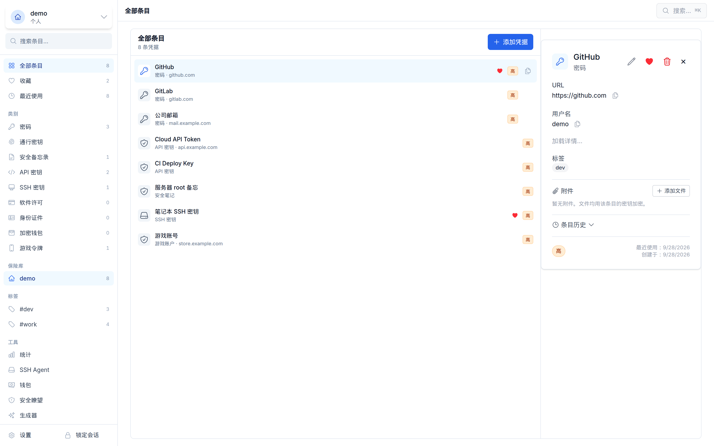
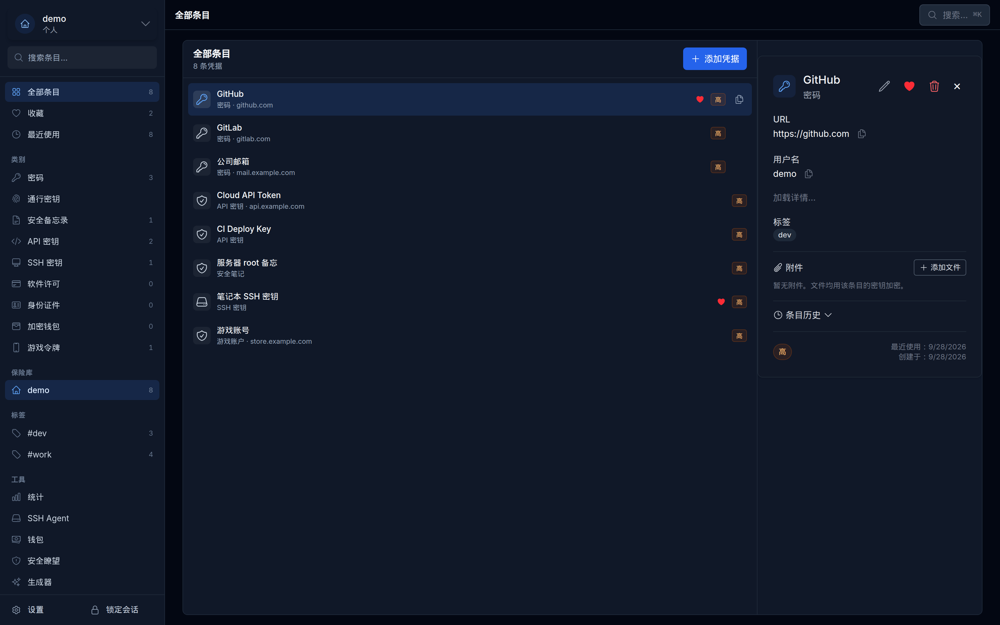
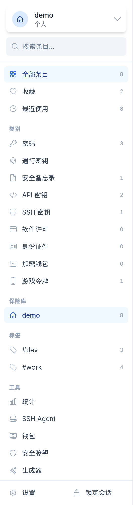
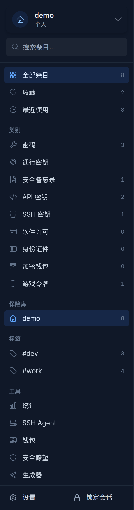
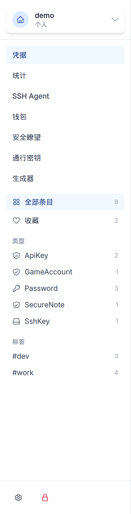
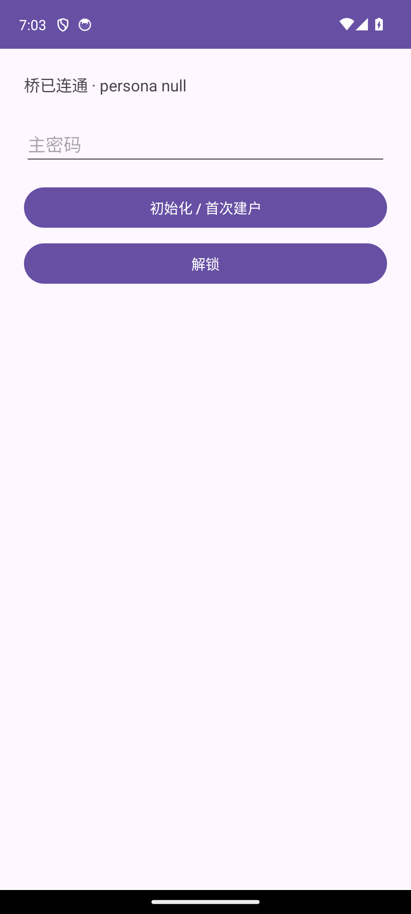
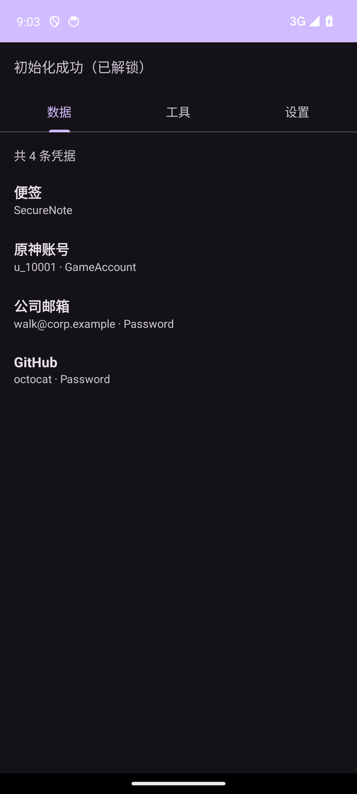
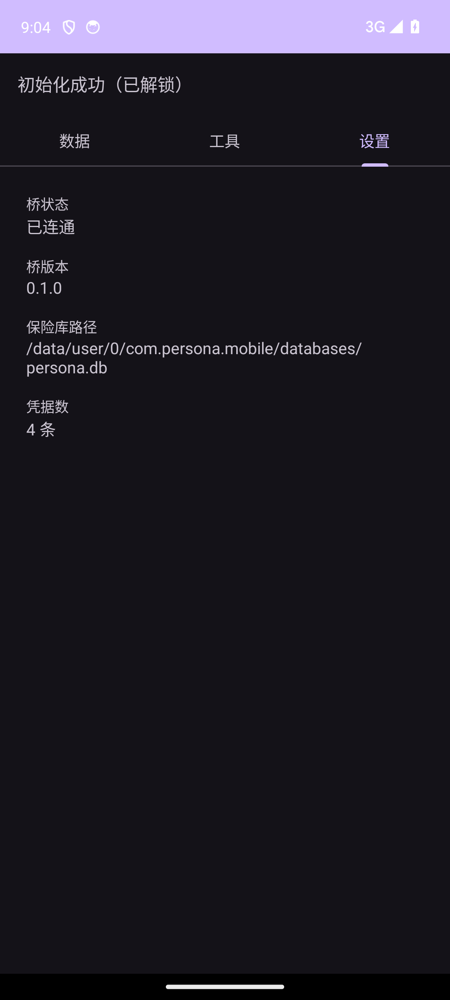
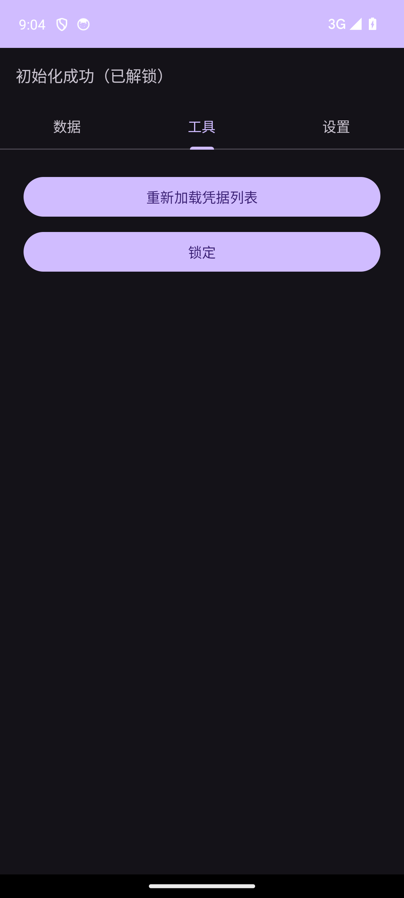

<div align="center">
  
  <h1>Persona</h1>
  <p><strong>本地优先的身份材料管理器</strong></p>
  <p>
    <a href="https://github.com/cuihairu/persona/actions/workflows/ci.yml"></a>
    <a href="https://codecov.io/gh/cuihairu/persona"></a>
    <a href="https://opensource.org/licenses/MIT"></a>
    
    
    
    
    
  </p>
</div>

> [English](README.md) | **中文**

管理你的数字分身，自信切换身份材料。

## 项目概述

Persona 是一个本地优先、零知识的管理器，服务于「一个人运营多个数字分身」的场景。每个身份都是一个独立的密钥与凭据上下文，用在不同的环境里——工作、个人浏览、基础设施访问或自动化。

产品聚焦身份域的凭据与开发者工作流：密码、API key、TOTP、SSH 密钥、浏览器自动填充，以及当前身份切换。钱包材料同样属于这套概念模型，但目前是延后处理的优先级，不在主线产品范围内。

### 核心特性

- 身份域保险库：密码、TOTP/HOTP 密钥、API key、SSH 密钥、标签与安全元数据
- 开发者工具：内置 SSH agent、CLI 工作流、便于自动化的凭据访问
- 上下文感知建议：`suggest`/`shell-hook`/`use` 依据 cwd/仓库/主机建议合适的分身——只建议，绝不静默授权
- 桌面 Quick Access：OS 级全局热键唤出检索浮窗与密码生成器浮窗（可选开关，默认关闭）
- 浏览器辅助：自动填充、建议、防钓鱼、按站点设置身份默认值
- Passkey（WebAuthn）：ES256/P-256 密钥封装在逐条目的密钥层级之下，可在 CLI 创建 / 列出 / 自测
- 端到端加密同步：多设备凭据同步，服务端只见到密文，冲突裁决界面，群组密钥轮换
- 可选自托管：Persona Server（Rust + Axum）提供同步、账号、备份与零知识配对中继
- 导入导出：JSON/YAML/CSV，可选 gzip 压缩与口令加密（Argon2id + AES-GCM）
- 审计日志：关键操作与签名事件（带摘要）
- 本地优先的安全：零知识存储、自动锁定、操作确认与供应链检查

## 界面预览

### 电脑版 — 1600×1000 窗口（2× DPR 截图，3200×2000 像素）

1Password 风格侧边栏改版之后的桌面保险库：条目、分类、保险库、标签与工具
都收在同一个侧边栏里，右侧是条目详情面板。

<p align="center">
  
  
</p>

<p align="center">
  
  
</p>

<details>
<summary>侧边栏：改版前后对比</summary>

<p align="center">
  
  
</p>

</details>

### 手机版 — Android 手机，1080×2400 像素

解锁页、凭据列表、工具与设置——Android 真机界面，默认（zh-CN）语言，深色主题。

<p align="center">
  
  
</p>

<p align="center">
  
  
</p>

## 架构

### 单仓布局

```
persona/
├── core/               # Rust core library: models, crypto, storage, service layer
├── cli/                # Persona CLI: init/add/list/show/switch/export/import/ssh/...
├── agents/ssh-agent/   # Built-in SSH agent (UNIX socket; ed25519/RSA/ECDSA)
├── desktop/            # Tauri + React desktop client (sync, passkeys, conflict UI)
├── browser/            # Browser clients (Chromium extension, Safari extension)
├── mobile/             # Mobile clients (iOS, Android, HarmonyOS)
├── connect-server/     # Local automation endpoint (127.0.0.1 HTTP, scope token)
├── server/             # Optional sync/automation service (Rust + Axum + SQLite)
├── website/            # Marketing site (UmiJS)
└── docs/               # Documentation and roadmap
```

### 技术栈

- 核心库：Rust + sqlx + SQLite
- 密码学：Argon2id 密钥派生与 AES-256-GCM 对称加密（RustCrypto 系列 crate）
- 桌面端：Tauri + React + TypeScript
- 服务端：Rust + Axum（可选）
- 钱包：rust-bitcoin（BTC）与 alloy（EVM），用官方测试向量做回归验证

Persona 站在成熟的开源基础之上——Tauri、React、Axum、sqlx、rust-bitcoin、alloy——而不是替换它们；真正属于本仓库自研工作的是产品层（身份模型、策略引擎、配对协议、保险库层级）。

## 安全要点

- **零知识架构** – 服务端永远看不到用户明文数据
- **端到端加密** – AES-256-GCM 加上基于 Argon2id 的密钥派生
- **本地优先** – 所有敏感数据都在本地设备上加密 / 解密
- **带签名的审计轨迹** – SSH 签名连同 sha256 摘要与上下文元数据一起记录
- **策略管控** – SSH agent 可强制速率限制、交互式确认，以及可选的 `known_hosts` 校验

## 快速开始

### 环境要求

- Rust 1.97+（通过 `rust-toolchain.toml` 钉版，保证可复现构建）
- Node.js 18+

### 构建与安装（CLI + Agent）

```bash
# Clone the repository
git clone git@github.com:cuihairu/persona.git
cd persona

# Build CLI and SSH agent
cargo build --workspace

# Optional: run local CI checks
make ci
```

### JS/桌面依赖（pnpm）

```bash
# Install workspace dependencies (desktop + browser extension + website)
pnpm install

# Run the desktop client in dev mode
pnpm --filter desktop run dev

# Build the browser extension bundle
pnpm --filter persona-chromium-extension run build

# Run the website in dev mode
pnpm --filter persona-website run dev
```

### 初始化工作区与基本操作

```bash
# Initialize an unencrypted workspace
persona init --path ~/PersonaDemo --yes

# Initialize an encrypted workspace with a master password
persona init --path ~/PersonaSecure --yes --encrypted --master-password "your_password"

# Add / show / list identities
persona add
persona show <name>
persona list

# Switch the active identity (Workspace v2 persists the state)
persona switch <name>

# 切回上一个身份（从审计轨迹解析）
persona switch --previous

# Run migrations to keep the schema up to date
persona migrate

# Credential management (passwords, API keys, etc.)
persona credential add --identity alice --name "GitHub" --credential-type password --prompt-secret
persona credential list --identity alice --format table
persona credential show --id <UUID> --reveal
persona credential remove --id <UUID>

# Item history (1Password-style): every create/update/delete is recorded with
# field-level diffs; encrypted payloads only ever show as "<encrypted>"
persona credential history --id <UUID>

# Attachments (1Password-style): files are encrypted with the owning item's
# key and stay decryptable across master-password rotation
persona credential attach --id <UUID> --file ~/Documents/recovery-codes.txt
persona credential attachments --id <UUID>
persona credential save-attachment --attachment-id <UUID> --output ~/Downloads/recovery-codes.txt
persona credential remove-attachment --attachment-id <UUID>

# Custom fields (1Password-style): typed fields (text/concealed/date) with
# optional sections; the whole table is sealed under the item's per-item key.
# set-fields replaces the entire table; --clear removes all fields
persona credential set-fields --id <UUID> --field concealed:Bank:PIN=999999 --field text::Recovery=abc123
persona credential fields --id <UUID>            # concealed values masked
persona credential fields --id <UUID> --reveal   # confirm, then print values

# Secure Note (1Password-style): the body is stored fully encrypted under the
# per-item key — unlike the plain notes column on other item types
persona credential add --identity alice --name "Recovery codes" --credential-type note --note "1111-2222
3333-4444"

# Identity / Software License (1Password standard categories): document numbers
# and license keys are sealed under the item's key; unspecified fields stay empty
persona credential add --identity alice --name "Passport (main)" --credential-type identity \
  --first-name Alice --last-name Zhang --id-number 110101199001310011 --passport-number E12345678
persona credential add --identity alice --name "JetBrains All Products" --credential-type software-license \
  --license-key AAAA-BBBB-CCCC-DDDD --version 2024.2 --seats 3 --valid-until 2027-05-01

# TOTP (two-factor authentication) workflows
persona totp setup --identity alice --qr ~/Downloads/github.png
persona totp code --id <UUID>
persona totp code --id <UUID> --watch

# Steam Guard (game token; shared_secret is the base64 from the Steam authenticator export)
persona totp setup-steam --identity alice --account alice_steam --secret <base64-shared-secret>
persona totp code --id <UUID>   # game token credentials share the same code command

# Or import straight from a Steam Desktop Authenticator export (.maFile) —
# a single file or a whole directory; only verifier fields are stored, the
# Session/access_token credentials are listed and never imported
persona totp import-steam --identity alice --file ~/Downloads/maFiles/alice.maFile
persona totp import-steam --identity alice --file ~/Downloads/maFiles --yes

# Battle.net authenticator: export via a community tool (serial + restore code ->
# standard TOTP secret), then import like any TOTP with 8 digits
persona totp setup --identity alice --secret <base32-secret> --issuer Battle.net --digits 8

# HOTP（RFC 4226）计数器型令牌：同一条 setup 路径加 --hotp；
# otpauth://hotp/ 的 URI 与二维码会被自动识别入库
persona totp setup --identity alice --secret <base32-secret> --issuer LegacyOTP --hotp --counter 0
persona totp code --id <UUID>               # 使用入库时的起始计数器
persona totp code --id <UUID> --counter 5   # 显式计数器（仅 HOTP 条目）

# Vendor-bound game tokens (Tencent Game Security Center, NetEase Da Shen,
# miHoYo security token, ...): recorded as vault entries only — their seeds live
# inside the vendor's app, so codes must be generated there
persona totp setup-game-token --identity alice --provider tencent_security --account qq_123456 --url https://gamesafe.qq.com

# Passkeys (WebAuthn, software authenticator): ES256/P-256 keys sealed under
# the per-item key hierarchy; credential IDs are unique across the vault
persona passkey create --identity alice --rp github.com --user alice@example.com
persona passkey list --identity alice
persona passkey show <UUID>
persona passkey self-test <UUID>   # local register + assert round trip
persona passkey remove --id <UUID>

# Password generator with custom sets
persona password generate --length 32 --set lowercase --set uppercase --set digits --set symbols
persona password generate --pronounceable --length 18 --set lowercase --set uppercase

# Diceware-style passphrase from the EFF large wordlist (3-10 words, `-`-separated)
persona password generate --words 6

# TUI dashboard (ratatui + crossterm)
persona tui --identity alice   # optional: preselect identity
q to quit, r to reload, ↑/↓ or j/k to navigate

# Connect local automation (secrets automation): read-only HTTP API on
# 127.0.0.1 for scripts/CI — token plaintext is shown exactly once
persona connect token create --label "my CI script"
persona connect serve
curl -s -H "Authorization: Bearer $TOKEN" http://127.0.0.1:$PORT/api/v1/connect/items

# Secrets automation, CLI direct read (refs are IDENTITY/ITEM/FIELD)
persona secrets resolve work/deploy/api_key            # one value per line
persona secrets run --env GH_TOKEN=work/ci/api_key -- gh repo view
persona secrets k8s --name deploy --key password=work/deploy/password | kubectl apply -f -
persona secrets external   # Terraform external provider: stdin JSON -> stdout JSON
```

### 导出 / 导入（压缩 + 加密）

```bash
# Export to JSON with sensitive content (requires unlock)
persona export --include-sensitive --output backup.json

# Enable gzip compression and passphrase-based encryption
persona export --format yaml --compression 9 --encrypt --output backup.yaml

# Import (.json/.yaml/.csv); --decrypt prompts for the passphrase
persona import backup.enc --decrypt --mode merge --backup
```

### 从 1Password 迁移

先从 1Password 导出未加密的 `.1pux` 文件（Settings → Export），然后预览并导入：

```bash
persona import-1pux export.1pux --dry-run   # show the plan, touch nothing
persona import-1pux export.1pux             # confirm, then import
```

每个 1Password 保险库对应一个身份（同名身份会被复用）；Login 条目映射为密码凭据，
其中的 TOTP 密钥会拆成独立凭据，API Credential / SSH Key 条目映射到对应的 persona
类型。不支持的类别、已归档条目与附件会被报告并跳过——不会有内容被悄悄丢弃，
也不会被硬塞进有损的数据结构里。

### SSH Agent（开发者增强）

```bash
# Generate an SSH key (ed25519) and store it in the vault
persona ssh generate --identity <name> --name "GitHub Key"

# Start the built-in agent and print the export command
persona ssh start-agent --print-export
export SSH_AUTH_SOCK=...   # Copy to the current shell

# Provide the destination host and run a command
persona ssh run --host github.com -- ssh -T git@github.com

# Optional agent policies
export PERSONA_AGENT_REQUIRE_CONFIRM=1          # Prompt before every signature
export PERSONA_AGENT_MIN_INTERVAL_MS=1000       # Rate limit in milliseconds
export PERSONA_AGENT_ENFORCE_KNOWN_HOSTS=1      # Enforce known_hosts checks
export PERSONA_AGENT_CONFIRM_ON_UNKNOWN=1       # Ask before unknown hosts

# Status and shutdown
persona ssh agent-status
persona ssh stop-agent

# git commit signing (SSHSIG): install a copy of the binary named
# persona-ssh-sign, then point git at it
cp "$(command -v persona)" ~/.local/bin/persona-ssh-sign
git config gpg.format ssh
git config gpg.ssh.program ~/.local/bin/persona-ssh-sign
git config user.signingkey "persona:ssh:<credential-uuid>"
git commit -S   # signed with the vault key

# Distribute a vault public key to a host's authorized_keys (idempotent;
# --dry-run previews, --list reads, --remove revokes)
persona ssh authorize --identity work --host deploy@prod-1.example.com
```

### 上下文感知建议

上下文信号（cwd、仓库、目标主机）驱动一条**建议**——上下文只会提议分身，
绝不会替你授权：

```bash
# 输出当前目录/仓库对应的建议分身
persona suggest                # 人类可读
persona suggest --json         # 机器可读
persona suggest --short        # 只输出首选候选名（供 shell 提示符用）

# 在 shell 提示符里内联显示候选分身
# （输出一段代码片段，追加进 shell 配置文件即可）
persona shell-hook bash   # 或 zsh

# 确认建议（switch 的别名；审计会带上建议原因）
persona use

# 管理静态的上下文→分身映射（pattern：host/owner/repo，
# 或加 --host 用主机正则）
persona context map github.com/acme/api --identity work
persona context status
```

同一信号还接入更多面：`persona ssh run --host <host>` 连接前会在 stderr
打印一行分身建议；浏览器扩展弹窗会把建议分身的凭据排到最前。设
`PERSONA_NO_CONTEXT=1` 可整体关闭该层。本地 cwd→分身候选学习默认关闭
（`persona context learn status`）。

### 维护与工具

```bash
# 密码生成器（另有 --pronounceable，或 --words N 生成口令短语）
persona password generate --length 24
persona password generate --words 5 --count 3

# 保险库健康扫描：弱 / 重用 / 过期 / 陈旧凭据，仅元数据
persona watchtower
persona watchtower --check-breaches   # 附加 HIBP k-匿名泄露检查（仅出机 5 字符哈希前缀）
persona watchtower --json             # 机器可读报告

# 自动锁定策略（list/show/create/update/delete/assign/set-default/stats）
persona auto-lock list
persona auto-lock stats

# 轮换工作区主密码（重封装各密钥；钱包有独立口令，走 `persona wallet passwd`）
persona passwd

# 旅行模式：把标记的分身移出本设备，回来再恢复
persona travel mark <identity>   # 标记随身分身
persona travel enter             # 把标记分身打包加密进 sidecar 并移出主库
persona travel exit              # 输旅行口令从 sidecar 原样恢复
persona travel status

# 服务器加密备份（保管端点；push 无需解锁主密码）
persona backup push
persona backup list
persona backup pull <id> --out vault.enc
persona backup restore <id>
```

### 钱包（实验性）

加密钱包管理在延后的 M5 轨道上——该轨毕业前请按实验性对待：

```bash
# 创建钱包（BIP-39 助记词；BTC / ETH / Solana 派生）
persona wallet generate --name "Main" --network bitcoin --hd
# 仅watch：只要 xpub，本机不落任何私钥材料
persona wallet create-watch-only --name "Cold" --network bitcoin --xpub <XPUB>

# 地址与交易（标识符 = 钱包 ID 或名称；金额用链的最小单位——聪、wei……）
persona wallet list-addresses "Main"
persona wallet create-transaction "Main" --to <address> --amount 50000 --sign

# PSBT 工作流（离线签名往返；PSBT 以 base64 传递）
persona wallet export-psbt "Main" <address> 50000 140 --inputs <outpoint>
persona wallet sign-psbt "Main" <base64-psbt>
persona wallet finalize-psbt <base64-psbt>

# 钱包有独立口令，与主密码互不相干
persona wallet passwd "Main"
```

签名确认会校验收款地址、金额与链 ID，并带地址投毒启发式拦截；详见
[WALLET_DESIGN](https://github.com/cuihairu/persona/blob/main/docs/WALLET_DESIGN.md)。

## 文档

- [ONEPASSWORD_FEATURES](./docs/ONEPASSWORD_FEATURES.md) – 1Password 对齐的参考清单
- [FEATURE_GAP_ANALYSIS](./docs/FEATURE_GAP_ANALYSIS.md) – Persona 与 1Password 的对比
- [PASSKEYS_DESIGN](./docs/PASSKEYS_DESIGN.md) – passkey（WebAuthn）设计草案
- [MONOREPO](./docs/MONOREPO.md) – 单仓（monorepo）的取舍与工具链
- [UNINSTALL](./docs/UNINSTALL.md) – 卸载与数据保留（卸载不删数据，重装接续；显式 purge 步骤）
- [ROADMAP](./docs/ROADMAP.md) – 路线图与细化的 TODO 条目
- [TODO](./TODO.md) – 每日维护的任务清单
- [BRIDGE_PROTOCOL](./docs/BRIDGE_PROTOCOL.md) – 浏览器扩展 native messaging 协议
- [品牌素材](./docs/branding/README.md) – logo、字标、配色与使用规范

### 架构与设计

- [客户端通信架构](./docs/CLIENT_COMMUNICATION_ARCHITECTURE.md) – 统一的 IPC 架构
- [非交互模式指南](./docs/NON_INTERACTIVE_MODE.md) – CI/CD 集成指南
- [E2EE 同步设计](./docs/E2EE_SYNC_DESIGN.md) – 端到端加密同步设计（阶段 1–4 已落地）
- [存储与同步指南](./docs/STORAGE_AND_SYNC.md) – 存储与同步模式、双设备走查
- [群组同步模式](./docs/sync-group-mode.md) – 默认同步模式：动态口令 PAKE 配对、分批次的实现状态
- [自托管服务端](./docs/SELF_HOST_SERVER.md) – 自托管指南（部署、环境变量、API 端点）

### 安全文档

- [SSH Agent 功能](./docs/SSH_AGENT_FEATURES.md) – 完整的 SSH agent 文档
- [SSH Agent README](./agents/ssh-agent/README.md) – SSH agent 快速上手
- [SSH Agent 测试](./agents/ssh-agent/TESTING.md) – 完整测试指南
- [威胁模型](./docs/THREAT_MODEL.md) – 安全边界与定期复查清单
- [供应链安全](./docs/SUPPLY_CHAIN_SECURITY.md) – 依赖安全检查

## 路线图

优先级策略：密码管理器这条线先对齐 1Password；钱包方向保持实验性，等基础被验证后再推进（钱包的安全要求更高，需要单独的设计评审）。

- [x] 单仓、核心库、workspace v2、审计日志、导入导出（gzip + 加密）
- [x] 带完整策略引擎的 SSH agent（known_hosts、速率限制、按主机/按密钥规则、生物识别门禁）
- [x] 浏览器扩展 + native messaging 桥（自动填充 MVP、域名策略、防钓鱼）
- [x] CLI 对齐：CRUD、TOTP、密码生成器、TUI、非交互 CI 模式
- [x] 钱包材料（实验性）：在审计过的 crate（rust-bitcoin/alloy）上做 BTC/ETH/Solana 派生 + 签名
- [x] Passkey（WebAuthn）存储 + 自动填充
- [x] Watchtower 级健康检查（弱口令/复用/过期、泄露检查）
- [x] 桌面应用的数据打通与界面打磨
- [x] 可选同步/自动化服务，本地优先设计（E2EE 同步、账号、备份、配对中继）
- [x] 群组同步模式（默认）：动态口令 PAKE 配对、指令流同步、三种中继形态 —— S1–S5 全部落地（2026-10-05~10-10）
- [x] 钱包实验线：设计文档、签名确认（防地址投毒）、PSBT 单签、keystore JSON 导入导出（2026-10-13）；正式毕业仍等 Milestone 4 对齐之后

## 参与贡献

- 先读 [`docs/CONTRIBUTING.md`](./docs/CONTRIBUTING.md)，了解 Conventional Commits 与 PR 要求。
- Fork 本仓库并创建特性分支（例如 `git checkout -b feat/cli-edit`）。
- 写 PR / commit 标题时遵循 [Conventional Commits](https://www.conventionalcommits.org)，例如 `feat(cli): add credential filters`。
- 推送分支并发起 Pull Request，确保 `make lint-all` 与 `make test-all` 都通过。

## 许可证

本项目以 MIT License 发布，详见 [LICENSE](LICENSE)。

## 相关链接

- [问题追踪](https://github.com/cuihairu/persona/issues)

---

安全提示：Persona 迭代很快，API 与存储格式都可能变化。在接口稳定之前，不要用它管理生产环境的机密。

管理你的数字分身，自信切换身份材料。