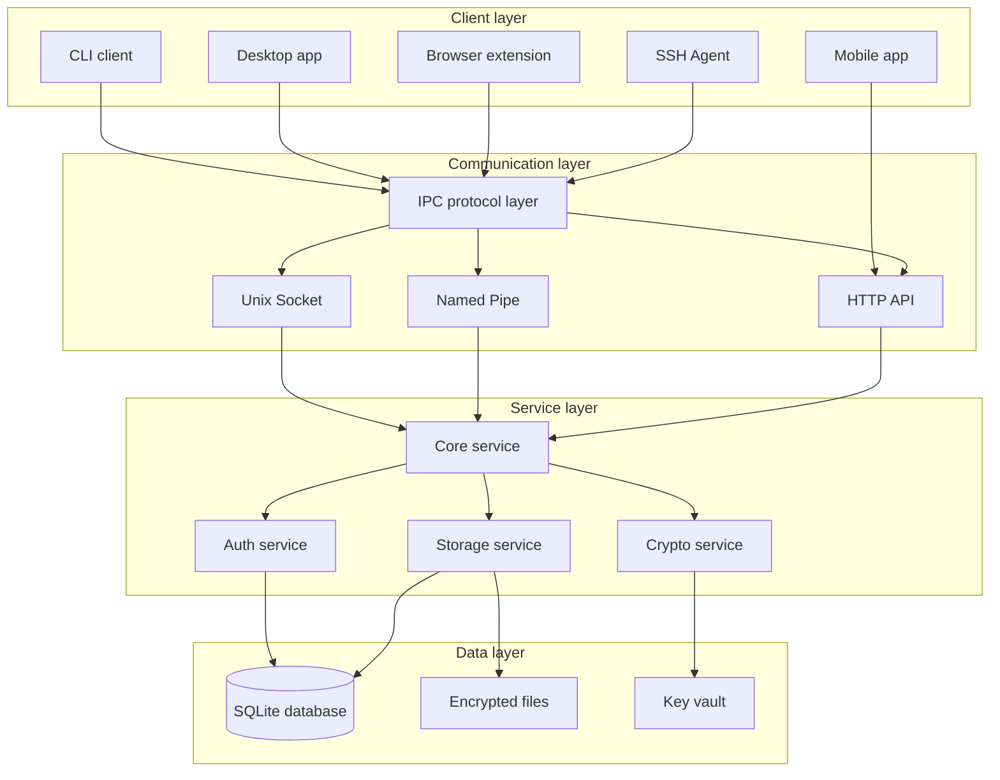

# Client Communication Architecture

> [English](CLIENT_COMMUNICATION_ARCHITECTURE.md) | [中文](CLIENT_COMMUNICATION_ARCHITECTURE.zh.md)

> **Status: target architecture / protocol design — NOT the current state.**
> The unified IPC layer described here (the `IpcMessage` message structure, the
> `identity.*`/`credential.*` RPC method table, `~/.persona/persona.sock`, JWT
> SessionToken, MessagePack+LZ4, the `PersonaPlugin`/`PluginManager` plugin system,
> the `persona-debug` debug binary, systemd/launchd units, `~/.persona/service.toml`,
> the connection pool / batch request / caching layer, trace_id, and so on)
> **does not exist in the code — it is the target design**. The actual client
> communication surface today is:
>
> - **Desktop (Tauri)**: holds `PersonaService` in-process; the frontend calls it via Tauri invoke, with no separate IPC daemon;
> - **Browser extension**: a Native Messaging host (`persona bridge`) opens the same SQLite workspace directly; there is also a dedicated Unix socket for passkey approval (`passkey-approval.sock`);
> - **SSH Agent**: a standalone `persona-ssh-agent` process plus a dedicated Unix socket / Windows Named Pipe;
> - **Connect automation**: `connect-server` embeds a desktop host process bound to `127.0.0.1`;
> - **Optional server**: persona-server (axum HTTP + hand-written Prometheus text metrics).
>
> For the current state, see [`LOCAL_SERVICE.md`](./LOCAL_SERVICE.md) and
> [`STORAGE_AND_SYNC.md`](./STORAGE_AND_SYNC.md). Read the rest of this document
> as a design draft, for comparison with future implementations.

The **target architecture** of the Persona digital identity management system is a
unified client communication design: all clients (CLI, desktop app, browser
extension, SSH Agent) are envisioned to communicate with a local service through
one standardized IPC protocol. This design is **not implemented today** (for the
current state, see the Status block above and `LOCAL_SERVICE.md`); the remainder
describes the target shape in design-mode terms.

## Architecture Overview



## Design Principles

### 1. Local-First

- **Primary transport**: Unix Socket (macOS/Linux) / Named Pipe (Windows)
- **Fallback**: HTTP API (cross-network or mobile devices)
- **Data sovereignty**: all sensitive data is stored and encrypted locally
- **Offline capability**: full functionality without a network connection

### 2. Unified Interface

- **Standard protocol**: all clients use the same IPC protocol
- **Type safety**: Rust-type-based serialization/deserialization
- **Version compatibility**: versioned protocol, backward compatible
- **Error handling**: a unified error response format

### 3. Security-First

- **End-to-end encryption**: encrypted communication from client to service
- **Permission checks**: session-based permission management
- **Audit logging**: a complete audit trail of all operations
- **Isolation**: permission isolation between different clients

### 4. Performance

- **Asynchronous communication**: non-blocking async operations
- **Connection pooling**: reuse connections to reduce latency
- **Batch operations**: support for batched requests and responses
- **Caching**: smart caching to reduce duplicate queries

## Communication Protocol Layers

### Layer 1: Transport Layer

#### Unix Domain Sockets (primary)

- **Path**: `~/.persona/persona.sock`
- **Permissions**: `0600` (owner-only access)
- **Characteristics**:
  - Zero copy, best performance
  - OS-level security isolation
  - Automatic cleanup (on process exit)

#### Named Pipes (Windows)

- **Path**: `\\.\pipe\persona-{user-id}`
- **Permissions**: user-specific access
- **Characteristics**:
  - Native Windows IPC mechanism
  - API-compatible with Unix Sockets
  - Supports asynchronous operations

#### HTTP/WebSocket (fallback)

- **Port**: `127.0.0.1:8080` (default)
- **Protocol**: HTTP/1.1 + WebSocket
- **Characteristics**:
  - Cross-network access
  - Mobile app support
  - Standard web technology stack

### Layer 2: Serialization Layer

#### Message format

```rust
#[derive(Serialize, Deserialize)]
pub struct IpcMessage {
    pub id: String,           // request ID
    pub version: String,      // protocol version
    pub method: String,       // method name
    pub params: Value,        // parameters
    pub timestamp: i64,       // timestamp
}

#[derive(Serialize, Deserialize)]
pub struct IpcResponse {
    pub id: String,           // ID of the request this responds to
    pub result: Option<Value>,// success result
    pub error: Option<IpcError>, // error information
    pub timestamp: i64,       // timestamp
}
```

#### Serialization protocol

- **Primary format**: MessagePack (binary, compact)
- **Fallback format**: JSON (text, debug-friendly)
- **Compression**: optional LZ4 compression

### Layer 3: RPC Layer

#### Method invocation patterns

```rust
// synchronous call
let identity = client.call("identity.get", params).await?;

// asynchronous notification
client.notify("auth.logout", params).await?;

// event subscription
let stream = client.subscribe("events.audit_log").await?;
```

#### Standard method naming

- **Identity management**: `identity.{create|read|update|delete|list|switch}`
- **Credential management**: `credential.{create|read|update|delete|list|search}`
- **Authentication operations**: `auth.{login|logout|verify|refresh}`
- **Configuration management**: `config.{get|set|reset}`
- **Audit logs**: `audit.{query|stream}`
- **System operations**: `system.{status|version|shutdown}`

## Client Implementations

### CLI Client

#### Characteristics

- **Synchronous interface**: blocking calls, suitable for scripting
- **Batch mode**: supports batch operations
- **Output formats**: multiple output formats (JSON, YAML, Table)

#### Implementation example

```rust
pub struct CliClient {
    transport: UnixTransport,
    session: Option<SessionId>,
}

impl CliClient {
    pub async fn connect() -> Result<Self> {
        let transport = UnixTransport::connect("~/.persona/persona.sock").await?;
        Ok(Self { transport, session: None })
    }

    pub async fn login(&mut self, password: &str) -> Result<()> {
        let response = self.call("auth.login", json!({
            "password": password
        })).await?;

        self.session = Some(response["session_id"].as_str().unwrap().into());
        Ok(())
    }
}
```

### Desktop App (Tauri)

#### Characteristics

- **Event-driven**: event-based reactive UI
- **Real-time updates**: real-time data via WebSocket subscription
- **Rich UI**: a full graphical user interface

#### Implementation example

```rust
// Tauri command
#[tauri::command]
async fn get_identities() -> Result<Vec<Identity>, String> {
    let client = get_client().await?;
    client.call("identity.list", json!({}))
        .await
        .map_err(|e| e.to_string())
}

// Frontend (React/TypeScript)
import { invoke } from '@tauri-apps/api/tauri';

const identities = await invoke('get_identities');
```

### Browser Extension

#### Characteristics

- **Cross-origin communication**: communicates with the local service via Native Messaging
- **Secure isolation**: extension sandbox environment
- **Auto-fill**: DOM manipulation and form filling

#### Communication flow

```
Browser extension -> Native Host -> Unix Socket -> Core Service
       |                 |              |            |
   Content           Background      IPC Client   Business
   Script             Script         Proxy         Logic
```

#### Implementation example

```javascript
// extension side
chrome.runtime.sendNativeMessage(
  "com.persona.native",
  {
    method: "credential.search",
    params: { domain: "github.com" },
  },
  (response) => {
    if (response.result) {
      fillCredentials(response.result);
    }
  },
);
```

### SSH Agent

#### Characteristics

- **Standard protocol**: implements the OpenSSH Agent protocol
- **Bidirectional communication**: SSH Agent Protocol + Persona IPC
- **Policy control**: policy-based signature control

#### Communication pattern

```
SSH Client -> SSH Agent -> Core Service
     |           |             |
   SSH Protocol  Persona IPC  Database
   (standard)    (custom)      (SQLite)
```

## Server Architecture

### Core Service

#### Main components

```rust
pub struct PersonaService {
    pub auth: AuthService,
    pub identity: IdentityService,
    pub credential: CredentialService,
    pub audit: AuditService,
    pub config: ConfigService,
}
```

#### Startup flow

```rust
#[tokio::main]
async fn main() -> Result<()> {
    // 1. initialize the service
    let service = PersonaService::new().await?;

    // 2. start the IPC server
    let ipc_server = IpcServer::new(service.clone());
    let unix_listener = UnixListener::bind("~/.persona/persona.sock")?;

    // 3. start the HTTP server (optional)
    let http_server = HttpServer::new(service.clone());
    let http_listener = TcpListener::bind("127.0.0.1:8080")?;

    // 4. serve connections concurrently
    tokio::try_join!(
        ipc_server.serve(unix_listener),
        http_server.serve(http_listener),
    )?;

    Ok(())
}
```

### Session Management

#### Session lifecycle

```rust
pub struct Session {
    pub id: SessionId,
    pub user_id: UserId,
    pub created_at: DateTime<Utc>,
    pub last_activity: DateTime<Utc>,
    pub permissions: HashSet<Permission>,
    pub is_active: bool,
}

impl Session {
    // authentication check
    pub fn requires_auth(&self, operation: &Operation) -> bool {
        match operation {
            Operation::IdentityList => self.has_permission(Permission::IdentityRead),
            Operation::CredentialCreate => self.has_permission(Permission::CredentialWrite),
            _ => false
        }
    }
}
```

## Error Handling

### Unified error format

#### Error types

```rust
#[derive(Serialize, Deserialize, Debug)]
pub struct IpcError {
    pub code: ErrorCode,
    pub message: String,
    pub details: Option<Value>,
    pub trace_id: String,
}

#[derive(Serialize, Deserialize, Debug)]
pub enum ErrorCode {
    // authentication errors
    AuthenticationRequired,
    AuthenticationFailed,
    SessionExpired,

    // authorization errors
    PermissionDenied,
    InsufficientPrivileges,

    // business logic errors
    ResourceNotFound,
    InvalidInput,
    ConflictingOperation,

    // system errors
    InternalError,
    ServiceUnavailable,
    DatabaseError,
}
```

#### Error response example

```json
{
  "id": "req-123",
  "error": {
    "code": "AuthenticationRequired",
    "message": "Valid session required for this operation",
    "details": {
      "operation": "credential.create",
      "required_permission": "credential:write"
    },
    "trace_id": "trace-456"
  },
  "timestamp": 1640995200
}
```

## Performance Optimization Strategies

### 1. Connection Management

#### Connection pool

```rust
pub struct ConnectionPool {
    pool: Arc<Mutex<Vec<Connection>>>,
    max_size: usize,
    idle_timeout: Duration,
}

impl ConnectionPool {
    pub async fn get_connection(&self) -> Result<Connection> {
        // reuse an idle connection or create a new one
    }

    pub async fn return_connection(&self, conn: Connection) {
        // return the connection to the pool
    }
}
```

### 2. Batch Operations

#### Batch request format

```rust
#[derive(Serialize, Deserialize)]
pub struct BatchRequest {
    pub requests: Vec<IpcMessage>,
    pub atomic: bool,  // whether the batch is atomic
}

#[derive(Serialize, Deserialize)]
pub struct BatchResponse {
    pub responses: Vec<IpcResponse>,
    pub success_count: usize,
    pub error_count: usize,
}
```

### 3. Caching Strategy

#### Multi-level cache

```rust
pub struct CacheLayer {
    // L1: in-memory cache (fastest)
    memory_cache: Arc<RwLock<LruCache<String, Value>>>,

    // L2: local storage (medium)
    disk_cache: Arc<DiskCache>,

    // L3: database (slowest but authoritative)
    database: Arc<Database>,
}
```

## Security Considerations

### 1. Transport Security

#### Unix Socket permissions

```bash
# socket file permissions
chmod 600 ~/.persona/persona.sock

# directory permissions
chmod 700 ~/.persona
```

#### Named Pipe security (Windows)

```rust
use windows::Win32::Storage::FileSystem::*;

let pipe = CreateNamedPipeW(
    pipe_name,
    PIPE_ACCESS_DUPLEX,
    PIPE_TYPE_MESSAGE | PIPE_READMODE_MESSAGE,
    1,
    BUFFER_SIZE,
    BUFFER_SIZE,
    0,
    &security_attributes, // restrict to the current user
)?;
```

### 2. Authentication and Authorization

#### JWT session token

```rust
#[derive(Serialize, Deserialize)]
pub struct SessionToken {
    pub sub: UserId,      // user ID
    pub iat: i64,         // issued-at time
    pub exp: i64,         // expiration time
    pub permissions: Vec<Permission>,
}

impl SessionToken {
    pub fn verify(&self, secret: &[u8]) -> Result<bool> {
        // verify the signature and validity period
    }
}
```

### 3. Audit Logging

#### Communication audit

```rust
pub struct CommunicationAudit {
    pub session_id: SessionId,
    pub method: String,
    pub client_type: ClientType,
    pub timestamp: DateTime<Utc>,
    pub success: bool,
    pub error_code: Option<ErrorCode>,
}
```

## Development and Debugging

### 1. Protocol Testing

#### Unit tests

```rust
#[tokio::test]
async fn test_identity_create() {
    let mut client = TestClient::new().await;

    let response = client.call("identity.create", json!({
        "name": "Test User",
        "email": "test@example.com"
    })).await?;

    assert!(response["result"]["id"].is_string());
}
```

#### Integration tests

```rust
#[tokio::test]
async fn test_end_to_end_flow() {
    // start the test service
    let service = TestService::start().await;

    // exercise the full flow
    let client = CliClient::connect().await?;
    client.login("test-password").await?;

    let identity = client.create_identity("Test", "test@example.com").await?;
    let credential = client.create_credential(&identity.id, "password", "secret").await?;

    // verify the results
    assert_eq!(identity.name, "Test");
    assert_eq!(credential.type_, "password");
}
```

### 2. Debugging Tools

#### IPC monitor

```bash
# monitor all IPC traffic
persona-debug monitor --socket ~/.persona/persona.sock

# output format
# [2024-01-01T12:00:00Z] CLIENT->SERVER: identity.list {}
# [2024-01-01T12:00:01Z] SERVER->CLIENT: {result: [{id: "...", name: "..."}]}
```

#### Protocol analyzer

```bash
# analyze protocol messages
persona-debug analyze --file ipc-trace.log

# statistics
# Total requests: 1234
# Success rate: 98.5%
# Average latency: 12ms
# Top methods: identity.list (45%), credential.search (32%)
```

## Deployment Configuration

### 1. System Service Configuration

#### systemd (Linux)

```ini
[Unit]
Description=Persona Core Service
After=network.target

[Service]
Type=notify
User=%i
ExecStart=/usr/local/bin/persona-service
Restart=always
RestartSec=10
Environment=PERSONA_CONFIG_PATH=%h/.persona/config.toml

[Install]
WantedBy=multi-user.target
```

#### launchd (macOS)

```xml
<?xml version="1.0" encoding="UTF-8"?>
<!DOCTYPE plist PUBLIC "-//Apple//DTD PLIST 1.0//EN"
    "http://www.apple.com/DTDs/PropertyList-1.0.dtd">
<plist version="1.0">
<dict>
    <key>Label</key>
    <string>com.persona.service</string>
    <key>ProgramArguments</key>
    <array>
        <string>/usr/local/bin/persona-service</string>
    </array>
    <key>RunAtLoad</key>
    <true/>
    <key>KeepAlive</key>
    <true/>
</dict>
</plist>
```

### 2. Configuration Files

#### Service configuration (`service.toml`)

```toml
[server]
# Unix socket path
unix_socket_path = "~/.persona/persona.sock"
# Named pipe name (Windows)
named_pipe_name = "persona-{user-id}"
# HTTP bind address (optional)
http_bind = "127.0.0.1:8080"

[security]
# session timeout (seconds)
session_timeout = 3600
# maximum concurrent connections
max_connections = 100
# enable TLS (HTTP mode)
enable_tls = false

[performance]
# connection pool size
connection_pool_size = 10
# maximum batch size
max_batch_size = 100
# cache size (MB)
cache_size_mb = 128

[logging]
# log level
level = "info"
# enable IPC communication logging
log_ipc = false
# log file path
file_path = "~/.persona/logs/service.log"
```

## Extensibility

### 1. Plugin System

#### Plugin interface

```rust
pub trait PersonaPlugin: Send + Sync {
    fn name(&self) -> &str;
    fn version(&self) -> &str;

    // register RPC methods
    fn register_methods(&self, registry: &mut MethodRegistry);

    // plugin initialization
    async fn initialize(&self, context: &PluginContext) -> Result<()>;

    // plugin cleanup
    async fn cleanup(&self) -> Result<()>;
}
```

#### Dynamic loading

```rust
pub struct PluginManager {
    plugins: Vec<Box<dyn PersonaPlugin>>,
    registry: MethodRegistry,
}

impl PluginManager {
    pub async fn load_plugin(&mut self, path: &Path) -> Result<()> {
        // dynamically load the plugin library
        let lib = unsafe { libloading::Library::new(path)? };
        let constructor: Symbol<fn() -> Box<dyn PersonaPlugin>> =
            unsafe { lib.get(b"create_plugin")? };

        let plugin = constructor();
        plugin.register_methods(&mut self.registry);
        plugin.initialize(&self.context).await?;

        self.plugins.push(plugin);
        Ok(())
    }
}
```

### 2. Third-Party Integration

#### External service connectors

```rust
pub trait ExternalConnector: Send + Sync {
    async fn authenticate(&self, credentials: &Credentials) -> Result<Session>;
    async fn sync_identities(&self, identities: &[Identity]) -> Result<()>;
    async fn import_credentials(&self) -> Result<Vec<Credential>>;
}

// Example: 1Password connector
pub struct OnePasswordConnector {
    api_token: String,
    vault_id: String,
}

impl ExternalConnector for OnePasswordConnector {
    async fn import_credentials(&self) -> Result<Vec<Credential>> {
        // import credentials from 1Password
    }
}
```

## Monitoring and Metrics

### 1. Performance Metrics

#### Key metrics

- **Connection count**: current active connections
- **Request latency**: 95th/99th percentile latency
- **Throughput**: requests per second (RPS)
- **Error rate**: percentage of failed requests
- **Memory usage**: service memory consumption
- **Database performance**: query execution time

#### Metrics collection

```rust
use prometheus::{Histogram, Counter, Gauge};

lazy_static! {
    static ref REQUEST_DURATION: Histogram = Histogram::with_opts(
        HistogramOpts::new("ipc_request_duration_seconds", "IPC request duration")
    ).unwrap();

    static ref ACTIVE_CONNECTIONS: Gauge = Gauge::with_opts(
        GaugeOpts::new("ipc_active_connections", "Active IPC connections")
    ).unwrap();

    static ref REQUEST_TOTAL: Counter = Counter::with_opts(
        CounterOpts::new("ipc_requests_total", "Total IPC requests")
    ).unwrap();
}
```

### 2. Health Checks

#### Health check endpoint

```rust
pub struct HealthChecker {
    database: Arc<Database>,
    service: Arc<PersonaService>,
}

impl HealthChecker {
    pub async fn check_health(&self) -> HealthStatus {
        let mut status = HealthStatus::new();

        // database connectivity check
        status.database = self.check_database().await;

        // service status check
        status.service = self.check_service().await;

        // disk space check
        status.disk_space = self.check_disk_space().await;

        status
    }
}
```

## Summary

Persona's client communication architecture uses modern design patterns:

1. **Unified IPC protocol** - all clients share the same communication standard
2. **Multi-layer transport support** - Unix Socket/Named Pipe as the primary means, HTTP as a fallback
3. **Security-first design** - end-to-end encryption, permission isolation, complete auditing
4. **High-performance optimization** - async processing, connection pooling, smart caching
5. **Developer-friendly** - type safety, error handling, debugging tools
6. **Extensible architecture** - plugin system, third-party integrations, monitoring metrics

This architecture gives Persona a solid communication foundation, supporting everything from simple CLI operations to complex desktop applications, while ensuring security, performance, and maintainability.

## References

- [Unix Domain Sockets programming guide](https://man7.org/linux/man-pages/man7/unix.7.html)
- [Windows Named Pipes documentation](https://docs.microsoft.com/en-us/windows/win32/ipc/named-pipes)
- [MessagePack serialization format](https://msgpack.org/)
- [Tauri IPC documentation](https://tauri.app/v1/guides/features/command)

---

**Maintainer**: Persona architecture team
**Last updated**: 2026-09-25 (first commit of this document; see the Status block at the top for the current-state boundary)
**Version**: v1.0 (design draft)
