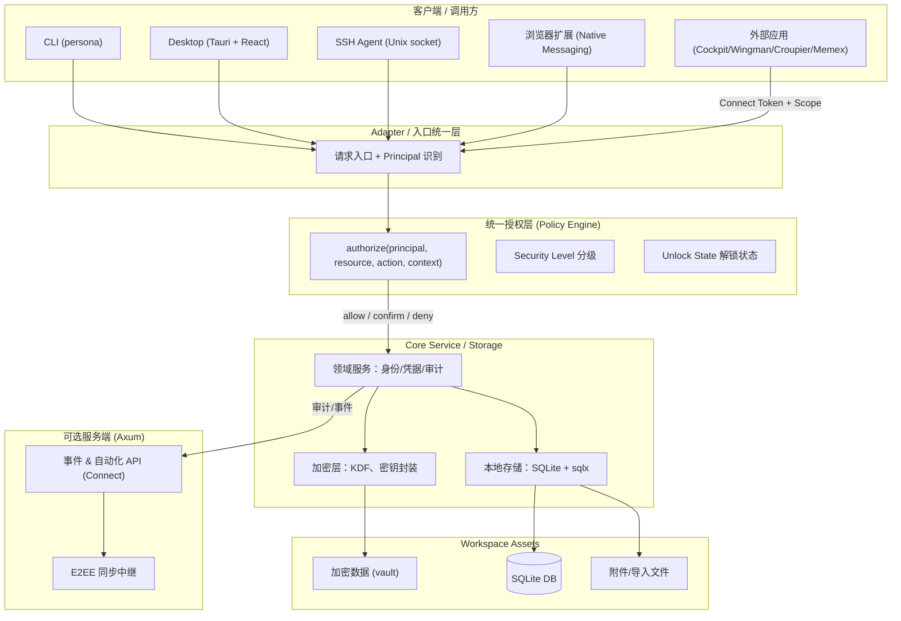
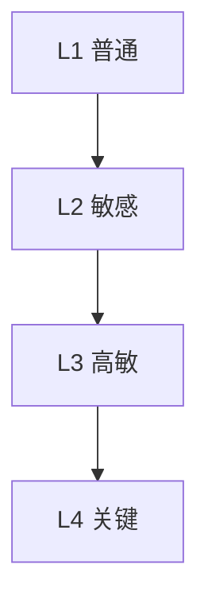
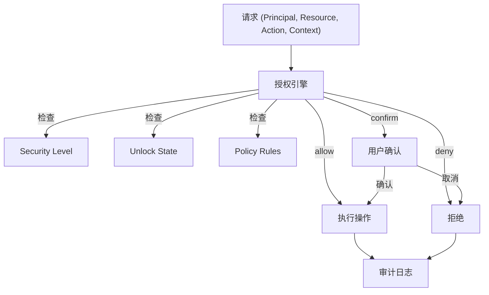
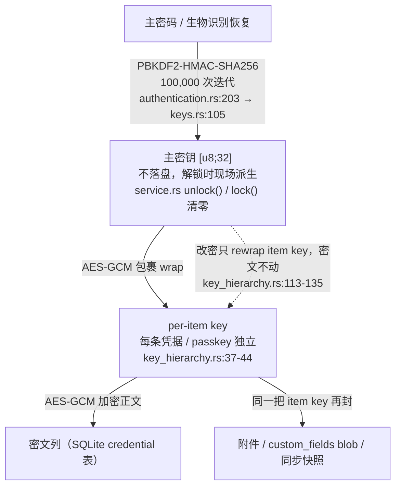

# Persona 目标架构与现有架构校正方案

> 本文档是给 Code Agent 的审查与校正指南，不是已实现架构的陈述。
> 目标：完善现有架构文档，确保授权模型、分级安全、受控自动化与真实代码一致。
> 日期：2026-10-12

---

## 1. 目标与约束

Persona 是本地优先、以安全为核心的身份与凭证管理器。本次校正的目标：

1. 明确身份、上下文、凭证、安全等级、授权与密钥保护之间的关系。
2. 建立统一授权入口，确保所有客户端和自动化调用遵循一致的安全规则。
3. 将受控自动化作为核心能力，不扩展成远程执行或任务编排平台。
4. 保持 Rust Core 为核心，复用现有客户端、存储与可选服务端。
5. **区分已实现、部分实现、规划中，不把规划写成已实现。**

### 产品边界

**Persona 负责**：密码/身份/凭证管理、分级安全、密钥保护、解锁状态、主体认证、凭证授权、策略决策、安全审计、CLI/桌面/浏览器扩展/SSH Agent/外部应用的凭证访问接口、可选加密同步。

**Persona 不负责**：机器资产管理、远程连接管理、SSH 命令执行、RDP/VNC 会话管理、任务调度、CI/CD 编排、执行 Agent 集群、通用企业 IAM 平台。

---

## 2. 目标架构图



---

## 3. 核心概念与实现状态

| 概念               | 定义                                     | 实现状态        | 代码依据                                                                           |
| ------------------ | ---------------------------------------- | --------------- | ---------------------------------------------------------------------------------- |
| **Principal**      | 调用主体（用户/CLI/Agent/扩展/外部应用） | **Unverified**  | 代码中无 `Principal` 类型定义，仅文档概念                                          |
| **Identity**       | 用户管理的身份或分身                     | **Implemented** | `core/src/models/identity.rs`                                                      |
| **Context**        | 当前工作上下文                           | **Partial**     | 有 workspace/identity 切换，无独立 Context 类型                                    |
| **Material**       | 受保护的凭证与身份材料                   | **Implemented** | `core/src/models/credential.rs` (`CredentialData` 枚举)                            |
| **Resource**       | 目标 Vault 或 Material                   | **Implemented** | Credential/Identity UUID                                                           |
| **Action**         | 操作类型（read/use/fill/sign/export）    | **Partial**     | `ConnectVerb` 只有 `Read`，SSH Agent 有签名但无统一 Action 枚举                    |
| **Policy**         | 授权决策规则                             | **Partial**     | `AutoLockPolicy` 是自动锁定策略，非统一授权入口                                    |
| **Security Level** | 材料保护等级                             | **Implemented** | `core/src/models/credential.rs:83` `SecurityLevel` 枚举 (Low/Medium/High/Critical) |
| **Unlock State**   | 安全域解锁状态                           | **Implemented** | `core/src/auth/` 解锁/锁定逻辑                                                     |

---

## 4. 安全等级模型



| 等级 | 典型材料             | 保护要求                    | 实现状态                                  |
| ---- | -------------------- | --------------------------- | ----------------------------------------- |
| L1   | 网站密码             | 解锁即可读                  | **Implemented** (`SecurityLevel::Low`)    |
| L2   | API Key、开发凭证    | 解锁 + 上下文隔离           | **Implemented** (`SecurityLevel::Medium`) |
| L3   | 生产管理员、SSH 私钥 | 解锁 + 确认 + 限制导出      | **Partial** (有等级字段，无独立密钥边界)  |
| L4   | 钱包助记词、根私钥   | 独立密钥保护边界 + 严格解锁 | **Unverified** (无独立密钥边界证据)       |

**关键缺口**：`security_level` 字段存在，但高等级是否有独立密钥保护边界、是否能在主 vault 解锁后保持锁定，**需要代码审查确认**。

---

## 5. 统一授权模型

### 目标流程



### Action 粒度（目标）

| Action          | 语义       | 当前支持       |
| --------------- | ---------- | -------------- |
| `list_metadata` | 查看元数据 | Partial        |
| `read_secret`   | 读取明文   | Connect `Read` |
| `copy_secret`   | 复制       | Partial        |
| `autofill`      | 填充       | 浏览器扩展     |
| `sign`          | 私钥签名   | SSH Agent      |
| `export_secret` | 导出       | CLI export     |
| `share_secret`  | 共享       | 未实现         |

**关键规则**：允许 `sign` ≠ 允许 `export_secret`。

---

## 6. 受控自动化契约

### 当前 Connect 实现

```rust
// core/src/connect/token.rs
pub struct ConnectTokenScope {
    pub identities: Vec<Uuid>,      // 资源范围：限定 Identity
    pub item_types: Vec<ConnectItemType>,  // 资源范围：限定类型
    pub verbs: Vec<ConnectVerb>,    // 操作范围：当前只有 Read
}
```

### 契约检查表

| 契约项       | 要求                     | 实现状态        | 缺口                               |
| ------------ | ------------------------ | --------------- | ---------------------------------- |
| 调用主体绑定 | Token 绑定明确 Principal | **Partial**     | Token 有 scope 但无 principal 字段 |
| 资源范围     | 限定 Vault/Material      | **Implemented** | `identities` + `item_types`        |
| 操作范围     | read/use/fill 区分       | **Partial**     | 只有 `Read`，无 `use`/`sign`       |
| 有效期       | 短期 Token               | **Unverified**  | 需确认 Token 是否有过期机制        |
| 撤销         | 支持撤销                 | **Implemented** | `revoke` 存在                      |
| 交互要求     | 非交互不能绕过确认       | **Partial**     | 需确认无人值守模式行为             |
| 输出最小化   | 返回执行所需结果         | **Implemented** | Connect 只读                       |
| 审计         | 记录成功/拒绝/敏感操作   | **Implemented** | 审计日志存在                       |

---

## 7. 架构校正任务清单

### 高优先级（校正文档与代码不一致）

- [x] **文档校正**：架构图中 `Principal` 标注为"预留"，但目标架构要求其为已实现概念。需更新文档为 **Planned** 或补全实现。（2026-10-12 落地：`core/src/authz.rs` 实现 `AuthzPrincipal`——LocalSession / ConnectToken{scope} / AgentKey 三类主体；架构图 "Entry + Principal 识别" 现有代码对应物即各入口构造 principal 后调用 `authorize()`）
- [x] **授权入口统一**：确认 CLI/桌面/SSH Agent/Connect 是否都经过同一授权检查。当前 SSH Agent 有策略检查，Connect 有 Token scope，但无统一 `authorize()` 入口。（2026-10-12 落地：`core/src/authz.rs` 的 `authorize(principal, resource, action, context)` 为唯一策略裁决点。四入口全部改走它：① core 数据面（`ensure_authorized` → get/update_credential_data、passkey assertion/self-test/export）；② Connect 四读端点（`token_allows_read` = authorize 的 404 形映射，动词+身份+类型三维裁决）；③ SSH Agent（签名入口先过 authorize 的 Sign-only 动作边界，`SignatureDecision::to_authz` 把条件策略折算到统一裁决词汇）；④ CLI 导出（两道确认框成为 Export→InteractionRequired 的履约，提示文案与默认值不变）。状态性机制不变：会话锁/自动锁/敏感重认证/token 吊销查表/agent 主机规则与频率计数仍各归其位。行为无回退：core 1070 测试全绿，connect 19 例全绿）
- [x] **Action 语义补全**：明确 `read` vs `use` vs `export` 的授权差异。当前 Connect 只有 `Read`，SSH 签名独立于 Connect。（2026-10-12 落地：`AuthzAction::{Read, Use, Export, Sign}` 统一动词模型。Connect token 目前只可授予 read（创建期 validate 强制不变）；agent 密钥 Sign-only（密钥材料不经 agent 读取/导出）；本地会话 Export 恒判 InteractionRequired（非交互上下文折叠为 Denied，fail-closed）；Use 归位解密展示与 passkey 断言类操作）

### 中优先级（补全契约）

- [x] **Connect Token 增加 principal 字段**：绑定调用方身份。（2026-10-12 落地：迁移 `019_connect_token_principal_expiry.sql` 加 `principal` 列；`create_connect_token` 接受 `Option<String>`，空/空白归一 `None`，≤256 字符；`ConnectTokenRow.principal` 随行，桌面 `ConnectTokenView` 暴露）
- [x] **Connect 支持 `use` verb**：允许签名操作但不允许导出。（2026-10-12 落地：`ConnectVerb::Use` 加入枚举，`validate` 收紧为 `{read, use}` 非空子集——export/sign 不是 Connect 动词，任何 scope 都不可能授予；`AuthzAction::connect_verb` 折算 Use→`ConnectVerb::Use`；纯 use token 读不到数据面。当前无签名端点，use 为未来签名/出码类端点的合法授权）
- [x] **Token 过期机制**：确认或实现短期 Token。（2026-10-12 落地：迁移 019 加 `expires_at` 列（NULL = 永不过期，旧数据语义不变）；`create_connect_token` 要求过期时刻在未来；`connect_authenticate` 对过期 token 与吊销同形拒绝（None + 节流记失败审计））
- [ ] **安全等级独立密钥边界**：确认 L4 是否能在主 vault 解锁后保持锁定。（补充事实，2026-10-12：迁移 019 同时补上 scope 拒绝审计——`audit_scope_denied` 对动词/身份参数/单条越 scope 记 `UnauthorizedAccess`（节流防刷屏，token id 载 resource_id 不载外键），此前 scope 拒绝零审计。密钥边界方案待用户拍板，未动加密层）

### 低优先级（文档完善）

- [x] **密钥层次图**：补充主密码 → 工作区密钥 → 凭证密钥的关系图。（2026-10-12 落地，见 [§11.1](#111-密钥层次图代码口径)。**口径修正**：实际不存在「工作区密钥」——层次是 主密码 →(PBKDF2-HMAC-SHA256 100k)→ 主密钥 →(AES-GCM 包裹)→ 每条凭据独立 item key；多 workspace 共享同一主密钥（单 vault 假设，见审计报告缺口 #10））
- [x] **身份切换状态机**：补充 Locked/Unlocked/StepUpRequired 状态转换。（2026-10-12 落地，见 [§11.2](#112-解锁与身份切换状态机代码口径)）
- [x] **组件职责表**：明确各组件"不负责"的边界。（2026-10-12 落地，见 [§11.3](#113-组件职责表不负责边界)）

---

## 8. 审查方法

Code Agent 应按以下步骤执行：

1. **代码审查**：确认 `Principal`、`Policy`、`authorize` 在代码中的真实存在性。
2. **路径追踪**：从 CLI/桌面/Agent/Connect 入口追踪到核心服务，确认是否经过统一授权。
3. **测试验证**：检查是否有授权相关的测试（拒绝未授权、跨上下文访问、敏感导出）。
4. **文档校正**：更新架构文档，使用 **Implemented / Partial / Planned / Unverified** 标签。
5. **报告输出**：列出修改文件、架构缺口、实现状态、安全风险。

---

## 9. 关键发现（预审查）

基于初步代码扫描：

| 发现                                      | 状态       | 影响                            |
| ----------------------------------------- | ---------- | ------------------------------- |
| `Principal` 类型在代码中不存在            | Unverified | 架构图与代码不一致              |
| `SecurityLevel` 枚举存在但无独立密钥边界  | Partial    | 分级安全可能只有标签无实质保护  |
| `ConnectTokenScope` 只有 `Read` verb      | Partial    | 无法支持 `use` 操作（SSH 签名） |
| `AutoLockPolicy` 是自动锁定策略非授权策略 | Partial    | 授权决策可能分散在各入口        |
| 无统一 `authorize()` 函数                 | Unverified | 各入口可能各自实现授权检查      |

---

## 10. 下一步行动

1. **代码 Agent 执行审查**：按第 8 节方法完成审查。
2. **校正架构文档**：更新 `docs/src/overview/architecture.md` 和 `docs/src/design/architecture.md`。
3. **补全关键实现**（如需）：统一授权入口、Connect `use` verb、Token principal 绑定。
4. **安全测试**：增加授权拒绝、跨上下文访问、敏感导出的测试。

**验收标准**：

- 所有敏感凭证访问路径都有明确的授权检查位置。
- 文档中的每个概念都能对应到真实代码、明确接口或标记为 Planned/Unverified。
- 自动化调用方不能仅凭凭证 ID 读取敏感数据。
- SSH 私钥使用与私钥导出有不同的授权语义。

---

## 11. 批3 落地明细（2026-10-12）

> 三项均按 [2026-10-12-audit-report.md](./2026-10-12-audit-report.md) 第 2 节的代码依据绘制——
> 本节不引入任何目标态设计，只把代码真实行为画清楚。Security Level 密钥边界方案（L4）
> 仍待拍板，未在此落地。

### 11.1 密钥层次图（代码口径）

**没有「工作区密钥」**：层次是两层（主密钥 → per-item key），多 workspace 共享同一把
主密钥。



**平行链（与主密钥链不相交）**：

| 链                  | 机制                                                                          | 依据                                                       |
| ------------------- | ----------------------------------------------------------------------------- | ---------------------------------------------------------- |
| 口令验证哈希        | Argon2id PHC（`PasswordHash`/`PasswordHasher`），**只做验证、不派生加密密钥** | `core/src/crypto/hashing.rs:17`、`authentication.rs:88-91` |
| 生物识别包裹        | `BIOWRAP1` 信封，**主密钥唯一持久化例外**                                     | `core/src/auth/biometric_wrap.rs:21-25`                    |
| 同步 GroupKey       | 独立 32B 密钥，存 OS keyring `persona-sync-group`，只封同步 oplog/信封        | `core/src/sync/keys.rs:18`                                 |
| 备份 / 旅行 sidecar | Argon2id（64MiB×3），**唯一用 Argon2id 加密的文件**                           | `core/src/backup/file_crypto.rs:29`                        |

**双哈希分工**（沿用旧口径会误判）：PBKDF2 派生**加密主密钥**，Argon2id 做**口令验证哈希**
与备份文件加密——审计报告第 4 节已把「Argon2id 派生密钥」的目标态描述收敛掉。

**图上故意不画 Security Level**：`SecurityLevel`（`models/credential.rs:83`）是纯标签，
无独立密钥边界、无等级化授权（审计报告缺口 #7）。分级只出现在存储映射、统计与展示层。

### 11.2 解锁与身份切换状态机（代码口径）

```mermaid
stateDiagram-v2
    [*] --> Locked
    Locked --> Unlocked: unlock(master_password)<br/>Argon2id 验证哈希通过后<br/>PBKDF2 派生主密钥入内存
    Locked --> Unlocked: 生物识别恢复<br/>unwrap BIOWRAP1 包裹
    Unlocked --> Locked: lock() 清内存密钥<br/>或 AutoLockManager 空闲 300s 巡检<br/>或 force_lock_sensitive 默认 true<br/>→ LockReason::SecurityViolation 强锁
    Unlocked --> StepUpRequired: 敏感操作且距上次认证 > 300s<br/>service.rs needs_reauth()
    StepUpRequired --> Unlocked: 重新认证通过
    StepUpRequired --> Locked: force_lock_sensitive<br/>（策略判为异常）
    Locked --> Locked: 账户连续 5 次失败<br/>锁 300s（authentication.rs:157-161）
    Unlocked --> Unlocked: switch_identity<br/>仅改 workspace.active_identity_id<br/>指针切换，不重派生密钥
```

| 状态           | 内存主密钥 | 数据面可读                                                     | Connect 数据面                                                                                 | 依据                                                                                                                                                            |
| -------------- | ---------- | -------------------------------------------------------------- | ---------------------------------------------------------------------------------------------- | --------------------------------------------------------------------------------------------------------------------------------------------------------------- |
| Locked         | 无         | 否，全 `VaultLocked`                                           | 否，`connect_gate` → `VaultLocked` → 端点 503                                                  | `service.rs` `is_unlocked()`/`lock()`；session `locked` 旗标（`auth/session.rs:116`）；AutoLock 巡检（`auth/auto_lock.rs:463-574`，默认 300s `service.rs:138`） |
| Unlocked       | 有         | 是                                                             | 是，scope 内（身份 × 类型 × 动词三维）                                                         | 敏感操作另受 300s 冷却窗口约束                                                                                                                                  |
| StepUpRequired | 有（未清） | 敏感操作被拒：`ReauthRequired` 错误变体，桌面/CLI 据此弹重认证 | 否——Connect 无人值守，重认证不可能；策略层 `InteractionRequired` 在非交互上下文折叠为 `Denied` | `auth/session.rs:105` `requires_sensitive_reauth`；折叠规则见 `core/src/authz.rs` 模块注释                                                                      |

**与状态机正交的条目级第二因子**：钱包种子的 `item_password_hash`（`models/credential.rs:305-308`）
——条目本身锁着，即使 Unlocked 也要再解一层。

### 11.3 组件职责表（不负责边界）

| 组件                                                                | 负责                                                                                                                  | 明确**不负责**                                                                                                                   |
| ------------------------------------------------------------------- | --------------------------------------------------------------------------------------------------------------------- | -------------------------------------------------------------------------------------------------------------------------------- |
| `core/src/service.rs`（`PersonaService` 单体，8858 行）             | 领域编排：解锁态编排、数据面/管理面授权组合（`ensure_authorized`）、审计落库、Connect 生命周期编排、TOTP/passkey 编排 | 加密原语（`core/crypto`）、HTTP/协议、UI、同步协议实现；管理面（token 创建/吊销、旅行模式）保持既有敏感门禁，不引入数据面动词    |
| `core/src/authz.rs`                                                 | 唯一策略裁决点 `authorize(principal, resource, action, ctx)`                                                          | **无状态**（会话锁/自动锁/敏感重认证、token 吊销查表、agent 主机规则与计数各归机制层）；不做交互履约（确认框在调用边）；不写审计 |
| `core/src/auth/`（authentication/session/auto_lock/biometric_wrap） | 认证与锁定机制：口令验证、会话旗标、自动锁巡检、生物识别包裹                                                          | 资源/动词裁决（在 `authz` + 各机制层）；AutoLock 是**锁定语义不是授权**                                                          |
| `core/src/crypto/`（key_hierarchy/encryption/passkey/…）            | 密钥层次与加密原语：PBKDF2 派生、AES-GCM 包裹/unwrap、re-wrap                                                         | 不知道授权、审计、身份与 workspace；对调用方是无状态纯函数                                                                       |
| `core/src/storage/`（repository、connect_repository、database）     | SQLite 行存取与迁移                                                                                                   | 业务判定不在 SQL 里（scope/等级/策略一律不进查询条件）；`audit_logs` 表只是存证载体                                              |
| `connect-server/`（本机 127.0.0.1）                                 | Connect HTTP 面：Host/Origin 三防线、限速、响应包络、token → service 映射                                             | 策略裁决（scope 判定在 core `authz`）、token 生成/哈希（`core/connect/token.rs`）；**不是** `server/` 的成员                     |
| `server/`（可选云服务）                                             | 账户、审计远端副本、备份端点                                                                                          | 无 Connect 端点；不接触主密钥与 vault 内容                                                                                       |
| `agents/ssh-agent/`                                                 | SSH agent 协议面 + 条件策略（主机规则/频率/确认计数）                                                                 | 密钥材料读取或导出（`authz` 层 `Export` 拒绝）；签名动作边界先过 core `authz`                                                    |
| `cli/`                                                              | 命令行 UX、导出确认框（`Export` 的履约边）、非交互模式                                                                | 策略裁决（消费 `authz` 结果）；确认文案与默认值是 UX，不是策略                                                                   |
| `desktop/src-tauri/`                                                | 桌面 UX、命令映射、Locked 事件独立任务、重认证弹窗                                                                    | **独立 cargo workspace**（不是根 workspace 成员，需单独 fmt/check）；授权判定                                                    |
| `core/src/events/emitter.rs`                                        | 审计远端副本（尽力而为）                                                                                              | 失败丢队列不回补；本地 SQLite `audit_logs` 才是存证源                                                                            |
| `core/src/sync/`（`keys.rs` GroupKey、materialize）                 | 同步协议与 GroupKey 平行链                                                                                            | 不接触主密钥；无分级同步（等级无关）                                                                                             |
