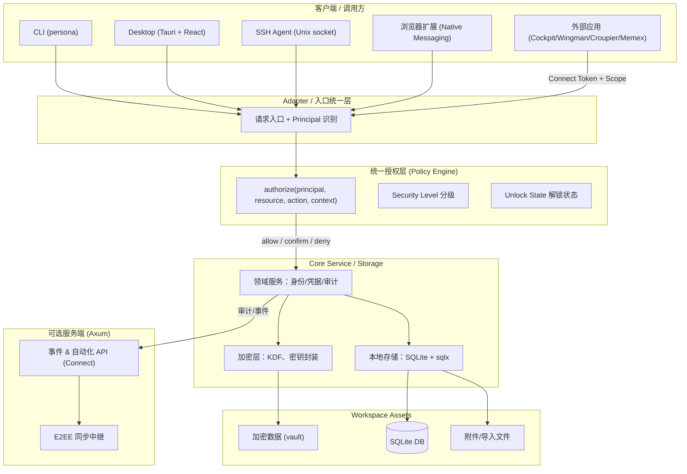
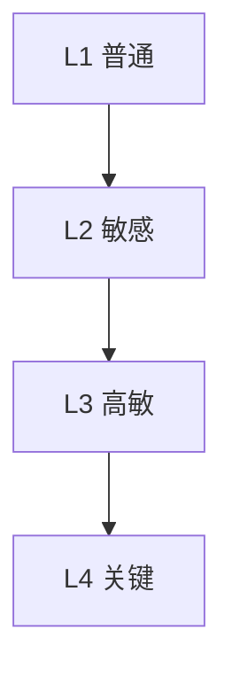
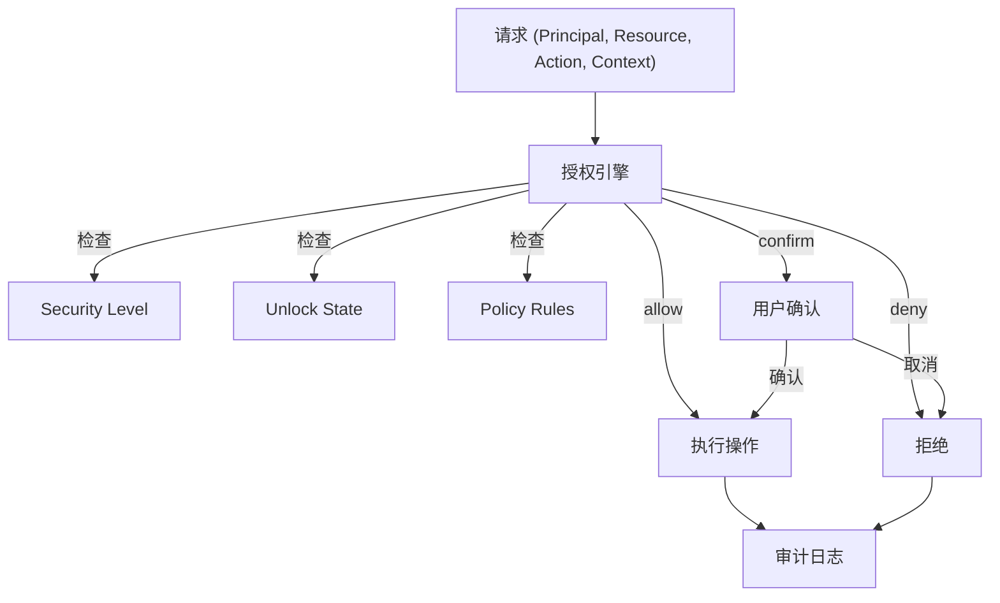

# Persona 目标架构与现有架构校正方案

> 本文档是给 Code Agent 的审查与校正指南，不是已实现架构的陈述。
> 目标：完善现有架构文档，确保授权模型、分级安全、受控自动化与真实代码一致。
> 日期：2026-10-12

---

## 1. 目标与约束

Persona 是本地优先、以安全为核心的身份与凭证管理器。本次校正的目标：

1. 明确身份、上下文、凭证、安全等级、授权与密钥保护之间的关系。
2. 建立统一授权入口，确保所有客户端和自动化调用遵循一致的安全规则。
3. 将受控自动化作为核心能力，不扩展成远程执行或任务编排平台。
4. 保持 Rust Core 为核心，复用现有客户端、存储与可选服务端。
5. **区分已实现、部分实现、规划中，不把规划写成已实现。**

### 产品边界

**Persona 负责**：密码/身份/凭证管理、分级安全、密钥保护、解锁状态、主体认证、凭证授权、策略决策、安全审计、CLI/桌面/浏览器扩展/SSH Agent/外部应用的凭证访问接口、可选加密同步。

**Persona 不负责**：机器资产管理、远程连接管理、SSH 命令执行、RDP/VNC 会话管理、任务调度、CI/CD 编排、执行 Agent 集群、通用企业 IAM 平台。

---

## 2. 目标架构图



---

## 3. 核心概念与实现状态

| 概念 | 定义 | 实现状态 | 代码依据 |
|------|------|---------|---------|
| **Principal** | 调用主体（用户/CLI/Agent/扩展/外部应用） | **Unverified** | 代码中无 `Principal` 类型定义，仅文档概念 |
| **Identity** | 用户管理的身份或分身 | **Implemented** | `core/src/models/identity.rs` |
| **Context** | 当前工作上下文 | **Partial** | 有 workspace/identity 切换，无独立 Context 类型 |
| **Material** | 受保护的凭证与身份材料 | **Implemented** | `core/src/models/credential.rs` (`CredentialData` 枚举) |
| **Resource** | 目标 Vault 或 Material | **Implemented** | Credential/Identity UUID |
| **Action** | 操作类型（read/use/fill/sign/export） | **Partial** | `ConnectVerb` 只有 `Read`，SSH Agent 有签名但无统一 Action 枚举 |
| **Policy** | 授权决策规则 | **Partial** | `AutoLockPolicy` 是自动锁定策略，非统一授权入口 |
| **Security Level** | 材料保护等级 | **Implemented** | `core/src/models/credential.rs:83` `SecurityLevel` 枚举 (Low/Medium/High/Critical) |
| **Unlock State** | 安全域解锁状态 | **Implemented** | `core/src/auth/` 解锁/锁定逻辑 |

---

## 4. 安全等级模型



| 等级 | 典型材料 | 保护要求 | 实现状态 |
|------|---------|---------|---------|
| L1 | 网站密码 | 解锁即可读 | **Implemented** (`SecurityLevel::Low`) |
| L2 | API Key、开发凭证 | 解锁 + 上下文隔离 | **Implemented** (`SecurityLevel::Medium`) |
| L3 | 生产管理员、SSH 私钥 | 解锁 + 确认 + 限制导出 | **Partial** (有等级字段，无独立密钥边界) |
| L4 | 钱包助记词、根私钥 | 独立密钥保护边界 + 严格解锁 | **Unverified** (无独立密钥边界证据) |

**关键缺口**：`security_level` 字段存在，但高等级是否有独立密钥保护边界、是否能在主 vault 解锁后保持锁定，**需要代码审查确认**。

---

## 5. 统一授权模型

### 目标流程



### Action 粒度（目标）

| Action | 语义 | 当前支持 |
|--------|------|---------|
| `list_metadata` | 查看元数据 | Partial |
| `read_secret` | 读取明文 | Connect `Read` |
| `copy_secret` | 复制 | Partial |
| `autofill` | 填充 | 浏览器扩展 |
| `sign` | 私钥签名 | SSH Agent |
| `export_secret` | 导出 | CLI export |
| `share_secret` | 共享 | 未实现 |

**关键规则**：允许 `sign` ≠ 允许 `export_secret`。

---

## 6. 受控自动化契约

### 当前 Connect 实现

```rust
// core/src/connect/token.rs
pub struct ConnectTokenScope {
    pub identities: Vec<Uuid>,      // 资源范围：限定 Identity
    pub item_types: Vec<ConnectItemType>,  // 资源范围：限定类型
    pub verbs: Vec<ConnectVerb>,    // 操作范围：当前只有 Read
}
```

### 契约检查表

| 契约项 | 要求 | 实现状态 | 缺口 |
|--------|------|---------|------|
| 调用主体绑定 | Token 绑定明确 Principal | **Partial** | Token 有 scope 但无 principal 字段 |
| 资源范围 | 限定 Vault/Material | **Implemented** | `identities` + `item_types` |
| 操作范围 | read/use/fill 区分 | **Partial** | 只有 `Read`，无 `use`/`sign` |
| 有效期 | 短期 Token | **Unverified** | 需确认 Token 是否有过期机制 |
| 撤销 | 支持撤销 | **Implemented** | `revoke` 存在 |
| 交互要求 | 非交互不能绕过确认 | **Partial** | 需确认无人值守模式行为 |
| 输出最小化 | 返回执行所需结果 | **Implemented** | Connect 只读 |
| 审计 | 记录成功/拒绝/敏感操作 | **Implemented** | 审计日志存在 |

---

## 7. 架构校正任务清单

### 高优先级（校正文档与代码不一致）

- [ ] **文档校正**：架构图中 `Principal` 标注为"预留"，但目标架构要求其为已实现概念。需更新文档为 **Planned** 或补全实现。
- [ ] **授权入口统一**：确认 CLI/桌面/SSH Agent/Connect 是否都经过同一授权检查。当前 SSH Agent 有策略检查，Connect 有 Token scope，但无统一 `authorize()` 入口。
- [ ] **Action 语义补全**：明确 `read` vs `use` vs `export` 的授权差异。当前 Connect 只有 `Read`，SSH 签名独立于 Connect。

### 中优先级（补全契约）

- [ ] **Connect Token 增加 principal 字段**：绑定调用方身份。
- [ ] **Connect 支持 `use` verb**：允许签名操作但不允许导出。
- [ ] **Token 过期机制**：确认或实现短期 Token。
- [ ] **安全等级独立密钥边界**：确认 L4 是否能在主 vault 解锁后保持锁定。

### 低优先级（文档完善）

- [ ] **密钥层次图**：补充主密码 → 工作区密钥 → 凭证密钥的关系图。
- [ ] **身份切换状态机**：补充 Locked/Unlocked/StepUpRequired 状态转换。
- [ ] **组件职责表**：明确各组件"不负责"的边界。

---

## 8. 审查方法

Code Agent 应按以下步骤执行：

1. **代码审查**：确认 `Principal`、`Policy`、`authorize` 在代码中的真实存在性。
2. **路径追踪**：从 CLI/桌面/Agent/Connect 入口追踪到核心服务，确认是否经过统一授权。
3. **测试验证**：检查是否有授权相关的测试（拒绝未授权、跨上下文访问、敏感导出）。
4. **文档校正**：更新架构文档，使用 **Implemented / Partial / Planned / Unverified** 标签。
5. **报告输出**：列出修改文件、架构缺口、实现状态、安全风险。

---

## 9. 关键发现（预审查）

基于初步代码扫描：

| 发现 | 状态 | 影响 |
|------|------|------|
| `Principal` 类型在代码中不存在 | Unverified | 架构图与代码不一致 |
| `SecurityLevel` 枚举存在但无独立密钥边界 | Partial | 分级安全可能只有标签无实质保护 |
| `ConnectTokenScope` 只有 `Read` verb | Partial | 无法支持 `use` 操作（SSH 签名） |
| `AutoLockPolicy` 是自动锁定策略非授权策略 | Partial | 授权决策可能分散在各入口 |
| 无统一 `authorize()` 函数 | Unverified | 各入口可能各自实现授权检查 |

---

## 10. 下一步行动

1. **代码 Agent 执行审查**：按第 8 节方法完成审查。
2. **校正架构文档**：更新 `docs/src/overview/architecture.md` 和 `docs/src/design/architecture.md`。
3. **补全关键实现**（如需）：统一授权入口、Connect `use` verb、Token principal 绑定。
4. **安全测试**：增加授权拒绝、跨上下文访问、敏感导出的测试。

**验收标准**：
- 所有敏感凭证访问路径都有明确的授权检查位置。
- 文档中的每个概念都能对应到真实代码、明确接口或标记为 Planned/Unverified。
- 自动化调用方不能仅凭凭证 ID 读取敏感数据。
- SSH 私钥使用与私钥导出有不同的授权语义。
