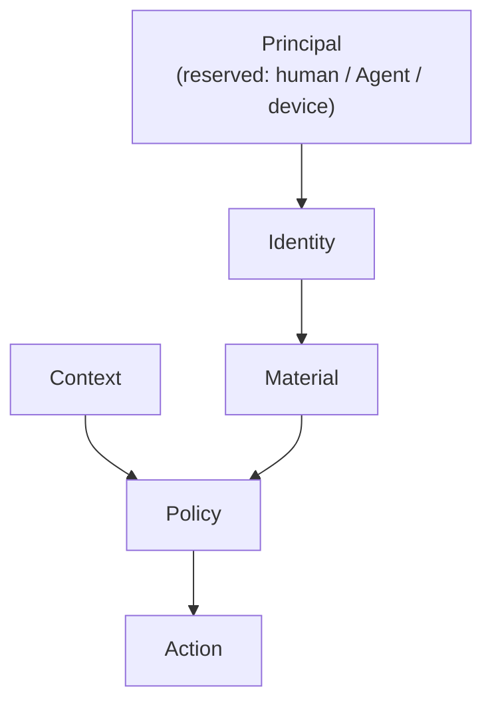

# Core Concepts

Persona is organized around six first-class concepts: **Identity, Context, Material
(identity material), Policy, and Action**, plus a reserved **Principal**. Together they
answer a single question:

> In a given digital environment, which identity does a person (or an agent, or a
> device) act under, which identity materials does it hold, through which policies, and
> which actions does it perform?

- [**Principal**](./principal): the initiator — an abstraction over humans, AI agents,
  and devices (a reserved direction, not yet implemented).
- [**Identity**](./identity): the distinct digital identities of one person; the
  **unit for organizing and switching** identity material.
- [**Context**](./context): environmental facts the client **can observe** (domain,
  host, directory, device…), used for suggestions and policy decisions.
- [**Material**](./material): passwords, SSH keys, API keys, TOTP, wallets, passkeys.
- [**Policy**](./policy): the rule set that decides "who, in which context, may perform
  which action on which material."
- [**Action**](./action): the concrete operation applied to a material — reveal, copy,
  fill, TOTP, generate, sign, save.

## Why these six concepts must stay separate

- **Identity ≠ Material**: your work identity's GitHub password, GitHub SSH key, and
  GitHub API key are three independent materials belonging to the same identity. What
  gets migrated, rotated, or shared is material — never the identity.
- **Material ≠ Action**: an SSH key carries no permission of its own; `sign` is the
  privileged action. Clients and browser extensions never hold plaintext directly —
  they request an Action that has passed policy checks.
- **Context ≠ user declaration**: context is observable fact (page origin, local host,
  directory), not a mode the user picks on a whim — which is why it can power
  **suggestions**, not **assertions**.
- **Policy is not a security detail**: it is the single adjudication entry point for
  every sensitive Action, a peer of the material model rather than a chapter in the
  encryption docs.

## Current state and roadmap (honest boundaries)

| Concept   | State                                                   | Where it lives                                                                       |
| --------- | ------------------------------------------------------- | ------------------------------------------------------------------------------------ |
| Identity  | ✅ Implemented                                          | `identities` table + active pointer (see User Guide: Identity)                       |
| Material  | ✅ Implemented                                          | credentials / crypto_wallets / passkeys tables (see [Identity Material](./material)) |
| Policy    | 🟡 Hard security gates implemented, partly configurable | origin binding, user gesture, SSH policy, approval gates (see [Policy](./policy))    |
| Action    | 🟡 Separated at the protocol layer                      | bridge request types + authorization gates (see [Action](./action))                  |
| Context   | 🟡 Some mechanisms landed                               | origin binding, per-identity filtering, site defaults (see [Context](./context))     |
| Principal | ⬜ Reserved, not implemented                            | direction outlined in [Principal](./principal)                                       |

> "Implemented" means it exists in code and is testable; "partially landed" means the
> mechanism exists but has not been abstracted into a first-class model, or only some
> entry points use it; "reserved" means a design direction, with no implementation
> commitment.

## Why this is not just another password manager

Password managers model the world as "one vault full of entries." Persona models the
world as:

- who (a Principal, including future Agents) holds which **identity**;
- which **materials** that identity owns — passwords are just one kind;
- in which **context**, under which **policy**, which **actions** are allowed.

So Password, SSH, TOTP, Wallet, Passkey, and browser autofill are not a feature
checklist — they are materials and actions under a single model. 1Password/Bitwarden
capabilities serve as a **feature baseline** (Persona's developer-facing features are
benchmarked against them), but the product's identity narrative is not "yet another
password manager."
