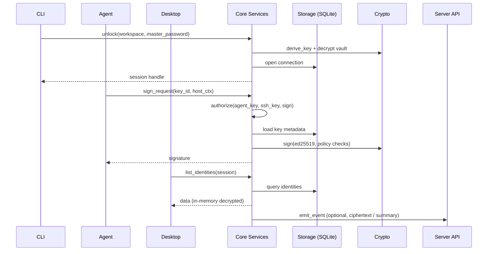

# 整体架构

> 本文描述当前代码的技术分层与模块交互。产品定位、愿景、能力边界与
> 概念模型层面的总体设计见产品定位与总体架构。
> 2026-10-12 审计后、批1/批2 落地后本页已与代码对齐；概念级的实现状态标签
> （Implemented/Partial/Planned/Unverified）见整体架构（概览）
> 与[架构实现状态审计报告](https://github.com/cuihairu/persona/blob/main/docs/review/2026-10-12-audit-report.md)。

## 分层设计

| 层           | 子模块                                                                                                 | 说明                                                                                                    |
| ------------ | ------------------------------------------------------------------------------------------------------ | ------------------------------------------------------------------------------------------------------- |
| 表现层       | CLI、Desktop、SSH Agent、未来移动端                                                                    | 负责交互体验、命令路由、通知等；不直接触达明文数据，只通过核心服务调用                                  |
| 核心领域层   | `core/src/service.rs`（PersonaService 单体）、`core/src/models/`、`core/src/storage/`（各 repository） | 承载领域模型、验证、策略门禁（如 SSH 签名确认、敏感操作再认证、Connect scope）                          |
| 授权层       | `core/src/authz.rs`（`authorize(principal, resource, action, ctx)`）                                   | 唯一纯策略裁决点：四入口收敛；`InteractionRequired` 由调用边履约，非交互折叠为 Denied；无状态，不写审计 |
| 安全与加密层 | `core::crypto`（PBKDF2 主密钥派生、Argon2id 口令验证哈希与备份文件加密、AES‑GCM、ed25519）             | 统一密钥派生、密文封装、密钥封存策略，确保 server/客户端一致；对授权/审计无感知                         |
| 数据与存储层 | `core::storage` (`sqlx` + SQLite)                                                                      | Workspace v2 schema、迁移、附件存储、审计日志                                                           |
| 可选服务层   | `server` (Axum)                                                                                        | 审计事件、E2EE 同步中继（冲突裁决在客户端完成）；无 Connect 端点                                        |

## 模块交互

> **与代码的对应关系（2026-10-12 审计，批1/批2 落地后更新）**：`unlock` 中派生主密钥用的是
> PBKDF2-HMAC-SHA256（口令验证为 Argon2id），解锁后内存持有 AES-GCM
> 封装服务（`core/src/service.rs:82`），按需解开 per-item key；
> 每个入口请求先过 `core/src/authz.rs::authorize` 纯裁决，再经各机制层
> 状态门禁；`sign_request` 的条件策略检查实现在 `agents/ssh-agent/src/policy.rs`
> （其四态决策经 `to_authz` 折算回统一词汇）；
> `emit_event` 为尽力异步（批量 + 指数退避，失败丢弃）。

## 数据存储

- **Workspace DB**：SQLite 文件，记录身份、凭据、SSH 密钥、设置等。通过 `sqlx::migrate!` 管理 schema，默认位于 `~/.persona/identities.db`（`cli/src/config/mod.rs:199`；workspace 路径可用 `PERSONA_WORKSPACE_PATH` 覆盖）。
- **加密形态**：没有独立的"vault 加密容器文件"——明文只存在 SQLite 密文列里，由主密钥（PBKDF2-HMAC-SHA256 派生，口令验证用 Argon2id）包裹的 per-item key 逐条加密（`core/src/crypto/key_hierarchy.rs`）；主密钥不落盘，解锁时现场派生。唯一例外是备份/旅行 sidecar（`PERSENC1` 格式，Argon2id 64MiB + AES-256-GCM，`core/src/backup/file_crypto.rs`）与生物识别包裹 blob（`core/src/auth/biometric_wrap.rs`）。
- **附件存储**：二进制 blobs（已实现，密文落盘、复用所属凭据的 item key，以内容哈希命名；不参与同步）。
- **审计日志**：SQLite `audit_logs` 表（`core/src/storage/repository.rs:1158`），记录 CRUD、签名、登录等操作；本地库为存证源，远端复制经 `core::events` Emitter 尽力异步（失败丢弃，见下[扩展点]）。

## 扩展点

- **服务端事件**：核心通过 `core::events::Emitter` 抽象写入本地或远端（Axum server、WebHook），支持批量与指数退避（失败丢弃不回补；本地 SQLite 审计库是持久存证源）。
- **授权入口**：`core/src/authz.rs::authorize` 是唯一策略裁决点，四入口（core 服务面 / Connect 数据面 / SSH Agent / CLI 导出）均已接入；新增入口只需构造 `AuthzPrincipal` + `AuthzResource` + `AuthzAction` 调用它，状态性门禁仍留在各机制层。
- **策略插件**：SSH Agent 提供策略 trait（`agents/ssh-agent/src/policy.rs` 的 `PolicyEnforcer` + `approval.rs` 的 `ApprovalHandler`），可扩展 biometrics、known_hosts 全量校验、审批工作流。core 侧的用户可配置规则机（`core/src/auth/security_strategies.rs`，时间/位置/设备/行为/网络条件）已具备求值骨架但尚未接线到任何入口，属规划件。
- **Connect 数据面**：`core/src/service.rs` 的 `connect_*` 方法读完整 token 行（principal + scope + 过期）；`core/src/connect/token.rs` 的 `ConnectTokenScope::validate` 限定 verbs 为 `{read, use}` 子集——扩展新动词需同步改枚举、validate 与 `AuthzAction::connect_verb` 折算。
- **同步**：已实现端到端加密凭据同步——server 中继密文操作日志（oplog），客户端引擎负责拉取物化与冲突裁决（LWW 定主位 + 人工裁决双版本）。

此设计让 Persona 可以在“纯离线”的情况下工作；server/sync 与浏览器扩展已落地，移动端保留清晰接口。
