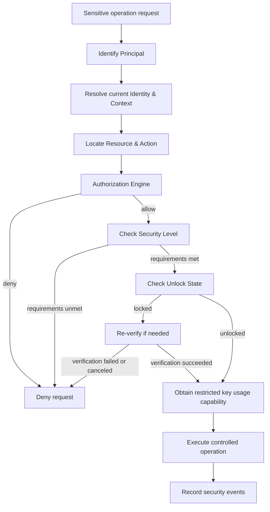

# Product Positioning & Overall Architecture

This document is Persona's product charter: positioning, vision, capability
boundaries, the core concept model, the overall architecture and module
relations, the tiered security and authorization system, the key hierarchy,
the scope of the first version, and the evolution principles. For technical
layering and module interactions, see the
overall architecture; for security invariants, see
the security design; for the item-by-item expansion of
the concept model, see the core concepts.

## 1. Product Positioning

### 1.1 One-Sentence Definition

Persona is a personal digital identity and credential management system that is
identity-centric, treats secret assets as the object of protection, and takes
tiered security and authorization mechanisms as its core.

It helps users centrally manage passwords, keys, tokens, recovery materials,
and other sensitive information across personal, organizational, and developer
identities, and controls how that information is accessed, used, shared, and
exported through unified security policies.

Persona does not merely store secrets; it is also responsible for deciding:

- Which identity is currently in use.
- Which secrets the current identity can access.
- Which applications may use a given credential.
- Which operations require additional verification.
- How secrets of different security tiers should be stored, unlocked, and used.
- Under what conditions reading plaintext, performing a signature, or exporting
  a secret is permitted.

### 1.2 What Problems Does Persona Solve?

As personal development environments, cloud services, and AI tools evolve, a
person typically has to manage many identities and a large number of sensitive
credentials at the same time. For example:

- Personal identity: personal email, personal GitHub, personal cloud services,
  personal passwords.
- Company identity: company email, internal Git services, company APIs,
  production environment credentials.
- Developer identity: SSH private keys, Git tokens, development environment
  keys, cloud platform credentials.
- High-security secrets: mnemonics, recovery phrases, root keys, and recovery
  materials for important accounts.

These secrets do not carry the same risk and should not be accessed in the same
way.

Traditional password managers mainly solve the storage and autofill of secrets;
operating system credential stores mainly solve credential storage and retrieval
in specific environments; identity and access management systems are usually
oriented toward organizations, account directories, and enterprise permission
management.

Persona wants to unify the parts of these needs that are directly related to
personal identity and secret protection, while keeping the product light
enough. It must answer not only "where are the secrets stored" but also "who
may use them under what conditions".

## 2. Product Vision

### 2.1 Vision

Give everyone a digital identity and secret management center of their own,
one that is secure.

Users should not have to mix all their passwords, keys, and recovery materials
in a single vault that can be accessed at will, nor should they have to hand
the plaintext of secrets to every application that needs credentials.

Through identity isolation, tiered protection, and fine-grained authorization,
Persona makes secret assets available when needed and protected when they
should not be used.

### 2.2 Core Philosophy

**Identity determines the context of use, authorization determines eligibility
for use, the security level determines protection requirements, and the key
hierarchy determines how secrets are protected.**

Together, these four form the security foundation of Persona.

### 2.3 Long-Term Goals

1. **Personal digital identity hub:** uniformly manage personal,
   organizational, and developer identities.
2. **Tiered secret vault:** apply different protection and unlocking mechanisms
   depending on the importance of each secret.
3. **Unified authorization center:** provide unified, auditable credential
   access control for local applications and trusted clients.
4. **Secure credential usage interface:** allow applications to invoke
   controlled signing, authentication, and credential retrieval capabilities
   without directly holding all the secrets.
5. **Extensible client ecosystem:** support desktop applications, CLI, browser
   extensions, and SSH Agent integrations through a stable local interface.

These goals should be built on one small security core rather than split into
multiple independent platforms.

## 3. Product Boundaries

### 3.1 What Persona Is Responsible For

| Capability               | Responsibility                                                            |
| ------------------------ | ------------------------------------------------------------------------- |
| Identity management      | Personal, organizational, and developer identities and their contexts     |
| Credential management    | Passwords, tokens, API keys, SSH private keys, and other secrets          |
| Tiered security          | Protection levels, unlock, and verification requirements per secret       |
| Authorization management | Permission decisions across subjects, resources, operations, and contexts |
| Key management           | Key hierarchy, derivation, wrapping, rotation, and secure storage         |
| Secret usage             | Controlled read, display, copy, signing, autofill, export, and sharing    |
| Security auditing        | Recording key authorization decisions and sensitive operation events      |
| Client interface         | A unified, secure entry point for trusted applications                    |

### 3.2 What Persona Is Not Responsible For

- General-purpose enterprise IAM, employee directories, and complex
  organizational management.
- Remote connections, remote desktop, and server session management.
- Task scheduling, automated execution, and remote execution agents.
- CI/CD workflow management and deployment orchestration.
- A general-purpose operations console.
- Complex distributed policy engines.
- A standalone business data management platform.

External applications can use Persona's credential capabilities, but the
concrete business flows remain the responsibility of the external application.
For example, an external SSH client can ask Persona to authenticate with a
certain SSH private key, but server connections, session display, and remote
operations are not Persona's responsibility.

## 4. Core Concept Model

Persona needs to clearly distinguish the following objects (corresponding to
the core concepts chapter).

### 4.1 Identity

Identity describes the role and context the user is currently working under,
for example Personal, Work, Developer, or a specific organization/project
identity (see Identity).

Switching identity changes the current operating context, but it must not
automatically grant new permissions, nor automatically unlock all secrets.

### 4.2 Principal

The Principal is the subject that actually issues a request (see
Principal). It can be:

- The current user.
- A registered device.
- An authorized desktop application.
- A CLI client.
- A browser extension.
- The SSH Agent or another trusted client.

Identity and Principal are not the same concept. Both the user's current
identity and the application actually issuing the operation take part in
authorization decisions.

### 4.3 Resource

A Resource is an object managed or protected by Persona, for example:

- A vault.
- A password entry.
- An SSH private key.
- An API token.
- A mnemonic.
- A protected key operation interface.

A resource can have an owning identity, a security level, and its own access
rules.

### 4.4 Action

Different operations on the same resource should be authorized separately (see
Action), for example:

- `read_metadata`: read non-sensitive metadata.
- `reveal_secret`: display the secret's plaintext.
- `copy_secret`: copy the secret.
- `use_credential`: use the credential to complete authentication.
- `sign`: invoke the private key to perform a signature.
- `export`: export the secret's plaintext.
- `share`: share the secret or authorize another subject to use it.

Being allowed to use a credential does not mean being allowed to read or export
its plaintext.

### 4.5 Security Level

The security level expresses the strength of protection a resource requires. It
is not the same as a permission, and it does not directly represent the current
unlock state.

The security level should influence key protection, unlock requirements,
verification strength, operation restrictions, and recovery policy.

### 4.6 Unlock State

The unlock state describes whether the current session or resource already meets
the unlock conditions required to perform an operation.

Persona as a whole can be in a usable state while a high-security vault remains
locked. The unlock scope should be kept as local as possible, so that a single
global unlock state does not expose all secrets at once.

## 5. Overall Architecture

Persona uses a layered architecture. Clients do not access the underlying secret
storage directly, nor do they decide permissions themselves; instead, they
complete operations through a unified secure execution entry point.


### 5.1 Clients and Integration Layer

This layer exposes Persona's capabilities to users and external applications,
including the desktop app, CLI, browser extension, and SSH Agent integrations.

It is responsible for interaction and protocol adaptation, not for implementing
independent security policies.

### 5.2 Product Capability Layer

This layer provides the business capabilities around identity, credentials,
vaults, resource metadata, and the client interface. It describes which
objects the system manages and how they relate to each other.

### 5.3 Security Core Layer

This is the most important part of Persona; it is responsible for the security
decisions of every sensitive operation. It includes at least:

- Identity and operation context resolution.
- The authorization engine.
- Security level and unlock policies.
- The unified secure operation entry point.
- Security auditing.

All clients must perform protected operations through this layer.

### 5.4 Key and Storage Layer

This layer is responsible for secret encryption, key derivation and wrapping,
key usage, and the persistence of encrypted data and metadata.

Business modules must not bypass the security core to obtain underlying
plaintext or decryption keys directly. Whether to use a system key store,
hardware security capabilities, or a dedicated encrypted vault should be chosen
according to platform capabilities and security levels, rather than assuming
that every platform offers the same protection capabilities.

## 6. Inside the Security Core

The overall architecture also needs to make clear how a sensitive operation is
actually executed.



The flow above is a logical illustration; the actual implementation can adjust
the order of checks depending on the operation type. For example, reading
ordinary metadata does not necessarily require unlocking secrets, while
exporting a high-security secret may require re-authentication or even
additional hardware verification.

The core rule is: **the operation may execute only when authorization, unlock,
and security requirements are all satisfied.**

## 7. Tiered Security System

Rather than just attaching a simple numeric level to each credential, Persona
should define enforceable protection profiles. Three default security levels are
recommended for the initial phase.

### Level 1: Ordinary Credentials

For ordinary website passwords, routine development tokens, and low-risk API
keys.

Basic requirements:

- Encrypted storage.
- Access under defined session conditions.
- Authorization according to identity and resource policies.
- Separate permission control over plaintext display, copying, and export.

### Level 2: Sensitive Credentials

For production SSH private keys, important cloud service keys, and
high-privilege API tokens.

Additional requirements:

- Stricter unlock conditions.
- Support for per-operation re-authentication.
- Restrict plaintext export.
- Audit important operations such as signing, copying, and export.
- Optionally restrict which clients are allowed to use them.

### Level 3: Root Secrets

For mnemonics, master recovery materials, root keys, and other high-value
secrets.

Additional requirements:

- Independent key protection and unlock boundary.
- Minimize exposure of the secret's plaintext.
- Strictly restrict application access and automated operations.
- Deny direct reading or export by ordinary clients by default.
- Require additional verification for important operations, and provide a clear
  recovery and backup strategy.

How each security level is concretely protected should be decided by policy (see
Policy). The level itself cannot replace authorization
decisions, nor can it be treated as an already-implemented security guarantee.

## 8. Identity Isolation and the Authorization System

### 8.1 The Relationship Between Identity and Resources

Every credential must have a clear owning scope, such as personal, company, or
a designated organization.

When switching identity, Persona updates the current operating context, but
does not automatically open another identity's resources to the current
subject.

### 8.2 Authorization Model

The first version is recommended to adopt a lightweight attribute-based access
control (ABAC) model, combined with explicit authorization rules and default
deny. The factors considered include:

- Principal: who is making the request.
- Identity: which identity is in use.
- Resource: which resource is accessed.
- Action: which operation is performed.
- Context: device, session, source application, and other security conditions.
- Security requirements: the protection requirements the operation must meet.

The first version does not need to implement complex enterprise role inheritance
systems or a general-purpose policy language.

### 8.3 Separation of Authorization and Key Usage

Persona should distinguish:

- Being authorized to read a secret.
- Being authorized to use a secret.
- Being authorized to export a secret.
- Being authorized to grant usage rights to other subjects.

For example, once an external SSH client has obtained the `sign` permission
for a given SSH private key, it can complete the signature through the
controlled interface provided by Persona, but it cannot read the private key's
plaintext on that basis.

This is an important difference between Persona and a mere encrypted password
storage tool.

### 8.4 Authorization Is Independent of the Security Level

Assume the current user has switched to the company developer identity:

- An ordinary GitHub token: the current identity is authorized and the vault is
  unlocked, so it can be used.
- A production SSH private key: the current identity is authorized, but the
  additional verification requirements have not been met, so it cannot be used
  for now.
- A personal wallet mnemonic: the company identity is not authorized, so it
  cannot be accessed even if other vaults are already unlocked.

These three outcomes are each determined jointly by authorization, unlock, and
identity isolation.

## 9. Key Hierarchy and Storage Design

Persona's key system should be separated from business authorization. The
following logical structure is recommended:

```text
User Authentication / Unlock Factors
                  |
                  v
       Key Encryption Key (KEK)
                  |
          Unwrap / Derive
                  |
                  v
        Vault Encryption Key
                  |
          Encrypt / Decrypt
                  |
                  v
       Credential Secret Data
```

For high-security secrets, a separate key hierarchy and stricter unlock
mechanisms can be used.

Key principles:

1. Never store secrets as plaintext fields in ordinary business databases.
2. Keep key material separate from the encrypted secret data.
3. Make the best possible use of the operating system key store, hardware
   security capabilities, or platform-provided protection mechanisms.
4. Avoid making every vault depend on a single long-lived master key held in
   plaintext.
5. Manage in-memory secrets, temporary buffers, the clipboard, and logs
   explicitly.
6. Design password change, key rotation, backup, and recovery mechanisms.
7. Root-secret recovery should be designed differently from everyday unlocking.

The concrete key derivation, encryption algorithms, randomness, authenticated
encryption modes, and key rotation protocols must be spelled out in a dedicated
security design phase; an architecture diagram alone does not make an
implementation secure.

## 10. Secure Operations and External Integration

All operations involving secrets should go through the unified Secure Operation
API, for example:

- `get_metadata`
- `reveal_secret`
- `copy_secret`
- `use_credential`
- `sign`
- `export_secret`
- `grant_access`
- `revoke_access`

These interfaces should use distinct permission semantics, avoiding a single
generic `get_secret` interface that covers every operation.

For external clients:

- A client must have an identifiable subject identity.
- Authorization must be bound to specific resources and operations.
- Authorization can carry an expiry, a revocation status, and a scope of
  application.
- Sensitive authorizations should have an explicit user-confirmation or
  re-verification mechanism.
- A client must not bypass the same security checks through another interface.
- When a client crashes or disconnects, it must not leave unnecessary long-lived
  unlock state behind.

The first version can start with local IPC and a CLI interface, then gradually
add browser extension, SSH Agent, and other integrations.

## 11. Security Auditing

The goal of auditing is to help users understand what happened with sensitive
operations, not to build a huge enterprise logging platform. The following
should be recorded:

- Authorization requests and their outcomes.
- Resource and operation types.
- The subject that issued the request.
- The identity context used.
- Whether additional verification was triggered.
- Authorization grant, modification, and revocation events.
- The outcome of sensitive operations.

Logs must avoid containing secret plaintext, passwords, tokens, mnemonics, and
other sensitive material.

For high-value operations, the integrity and traceability of audit information
should take priority.

## 12. First Version Product Scope

The goal of the first version is to form a complete, trustworthy, and usable
local security core, not to cover every client and enterprise need in one go.

### P0: Must Complete

- Identity and resource models.
- Credential and vault management.
- Tiered security and unlock state.
- A default-deny authorization engine.
- The unified secure operation entry point.
- Encrypted storage and the key hierarchy.
- Auditing of sensitive operations.
- Basic usage flows for the local desktop app or CLI.
- Security testing, backup, and recovery validation.

### P1: Added Incrementally

- External application authorization management.
- SSH Agent integration.
- Browser extension.
- Per-operation re-authentication.
- Finer-grained key usage and export restrictions.
- Cross-device sync and encrypted backup.

### Not Yet

- General-purpose enterprise IAM.
- Complex role inheritance and policy programming languages.
- Distributed authorization services.
- Remote execution and operations agents.
- CI/CD orchestration.
- Complex organizational management backends.

These features are only considered for expansion once clear product needs arise.

## 13. Architecture Evolution Principles

Persona's evolution must revolve around one core question:

**How can the right identity and the right applications use the right
credentials under the right conditions without enlarging the secret exposure
surface?**

Therefore:

- Identity management must not turn into an enterprise directory platform.
- The authorization engine must not turn into a general-purpose IAM product.
- Security levels must not degenerate into simple numeric labels.
- The unlock mechanism must not be a single global switch.
- Key storage must not be bypassed by ordinary business code.
- Client extensions must not duplicate or weaken the core security logic.

## 14. Final Product Definition

Persona is a personal digital identity and secret asset management system built
on a local security core.

It manages different usage contexts through identity isolation, controls
resources and operations through the authorization engine, constrains the
conditions under which secrets are available through tiered security and unlock
mechanisms, and protects the underlying secrets through the key hierarchy and
encrypted storage.

Its most important capability is not how many kinds of credentials it can hold,
but making secrets safely managed and used in a controlled way, without being
accidentally exposed to other identities and applications just because the user
switched identity or some application was granted authorization.

**Persona's core competitiveness: identity isolation + tiered security +
fine-grained authorization + controlled credential usage.**

Together, these four capabilities form the product's security core. The desktop
app, CLI, and other integrations are entry points into this core, not
independent security systems.

## 15. Design Points

Hold on to three key points:

1. **Persona should not be just a password manager.** If it only offers
   encrypted storage, password generation, and autofill, its difference from
   existing password manager products is not obvious enough. What is truly
   worth building is identity isolation, tiered secret protection, and the
   ability to give applications controlled credential usage.
2. **Authorization must be part of the core security architecture, not a
   permission management page.** Every sensitive operation — read, sign,
   export, share, and so on — should go through the unified security entry
   point. Otherwise the desktop app implements one authorization scheme and the
   CLI another, and paths that bypass the security policy will eventually
   appear.
3. **Tiered security must be reflected in the actual protection mechanisms.**
   Do not just label passwords, tokens, and mnemonics as L1, L2, L3. Different
   levels must actually influence key protection, unlocking, re-authentication,
   application access, and export restrictions.

One design decision to settle early: **identity, vault, and security level must
not be designed as concepts at the same layer.** Identity expresses the usage
context, the vault is responsible for resource organization and the protection
boundary, and the security level expresses protection requirements. They should
work in combination, but cannot replace one another.

Only then can Persona stay a small product while carrying a clear, extensible
security architecture.
