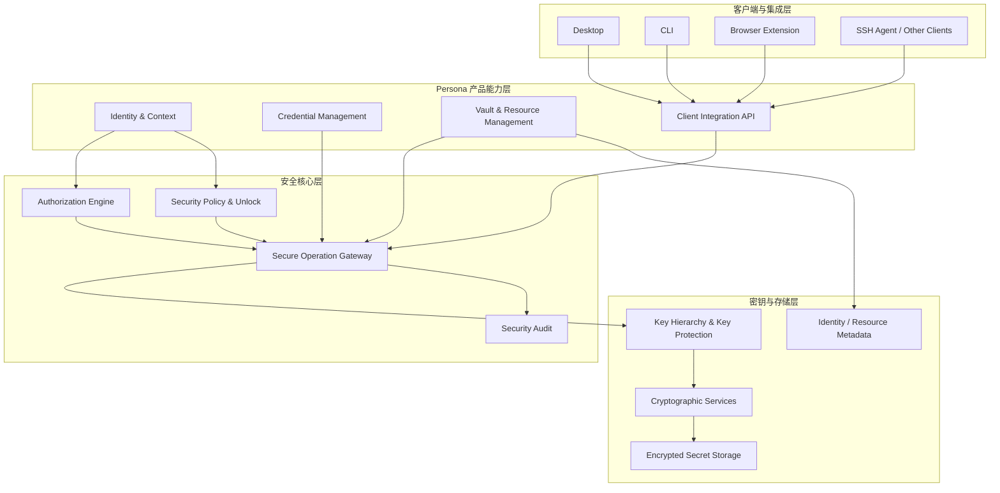
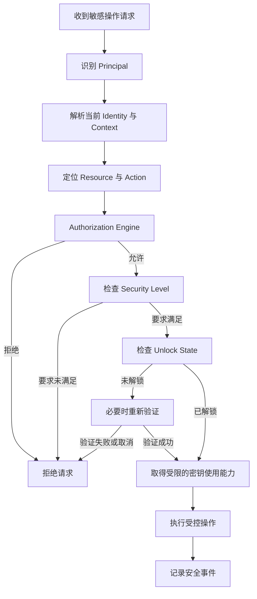

# 产品定位与总体架构

本文是 Persona 的产品总纲：定位、愿景、能力边界、核心概念模型、总体
架构与各模块关系、分级安全与授权体系、密钥层级、第一版范围与演进原则。
技术分层与模块交互见[整体架构](/design/architecture)，安全不变量见
[安全设计](/design/security)，概念模型的分项展开见
[核心概念](/concepts/index)。

## 1. 产品定位

### 1.1 一句话定义

Persona 是一个以身份为中心、以秘密资产为保护对象、以分级安全和授权
机制为核心的个人数字身份与凭证管理系统。

它帮助用户统一管理个人、组织和开发者等不同身份下的密码、密钥、Token、
恢复材料及其他敏感信息，并通过统一的安全策略控制这些信息如何被访问、
使用、共享和导出。

Persona 不只是存储秘密，还负责决定：

- 当前使用哪个身份。
- 当前身份能够访问哪些秘密。
- 哪些应用可以使用指定凭证。
- 哪些操作需要额外验证。
- 不同安全等级的秘密应该如何存储、解锁和使用。
- 在什么条件下允许读取明文、执行签名或导出秘密。

### 1.2 Persona 解决什么问题？

随着个人开发环境、云服务和 AI 工具的发展，一个人通常需要同时管理多种
身份和大量敏感凭证。例如：

- 个人身份：个人邮箱、个人 GitHub、个人云服务、个人密码。
- 公司身份：公司邮箱、内部 Git 服务、公司 API、生产环境凭证。
- 开发者身份：SSH 私钥、Git Token、开发环境密钥、云平台凭证。
- 高安全级别秘密：助记词、恢复短语、根密钥、重要账户恢复材料。

这些秘密并不具有相同的风险，也不应该采用相同的访问方式。

传统密码管理器主要解决秘密的存储和填充问题；操作系统凭证库主要解决
特定环境下的凭证存取问题；身份与访问管理系统则通常面向组织、账号目录
和企业权限管理。

Persona 希望将这些需求中与个人身份和秘密保护直接相关的部分统一起来，
同时保持产品足够轻量。它不仅要回答"秘密存在哪里"，还要回答"谁可以在
什么条件下使用它"。

## 2. 产品愿景

### 2.1 愿景

让每个人都拥有一个属于自己的、安全的数字身份与秘密管理中心。

用户不必把所有密码、密钥和恢复材料混在一个可以随意访问的保险库中，也
不必将秘密原文交给每个需要使用凭证的应用。

Persona 通过身份隔离、分级保护和细粒度授权，让秘密资产在需要时可用，
在不应该使用时受到保护。

### 2.2 核心理念

**身份决定使用语境，授权决定使用资格，安全等级决定保护要求，密钥体系
决定秘密如何受到保护。**

四者共同构成 Persona 的安全基础。

### 2.3 长期目标

1. **个人数字身份中心：** 统一管理不同个人身份、组织身份和开发者身份。
2. **分级秘密保险库：** 根据秘密的重要程度采用不同的保护与解锁机制。
3. **统一授权中心：** 为本地应用和可信客户端提供统一、可审计的凭证
   访问控制。
4. **安全凭证使用接口：** 允许应用调用受控的签名、认证和凭证获取
   能力，而不必直接持有全部秘密。
5. **可扩展的客户端生态：** 通过稳定的本地接口支持桌面应用、CLI、
   浏览器扩展和 SSH Agent 等集成。

这些目标应建立在同一个小型安全核心上，而不是拆成多个独立平台。

## 3. 产品边界

### 3.1 Persona 负责什么

| 能力       | 职责                                         |
| ---------- | -------------------------------------------- |
| 身份管理   | 个人、组织、开发者等身份及其上下文           |
| 凭证管理   | 密码、Token、API Key、SSH 私钥及其他秘密     |
| 分级安全   | 不同秘密对应的保护等级、解锁和验证要求       |
| 授权管理   | 主体、资源、操作和上下文之间的权限判断       |
| 密钥管理   | 加密密钥层级、密钥派生、包装、轮换及安全存储 |
| 秘密使用   | 受控读取、显示、复制、签名、填充、导出和共享 |
| 安全审计   | 记录重要授权决策与敏感操作事件               |
| 客户端接口 | 为可信应用提供统一的安全能力入口             |

### 3.2 Persona 不负责什么

- 通用企业 IAM、员工目录和复杂组织管理。
- 远程连接、远程桌面和服务器会话管理。
- 任务调度、自动化执行和远程执行代理。
- CI/CD 工作流管理和部署编排。
- 通用的运维控制台。
- 复杂的分布式策略引擎。
- 独立的业务数据管理平台。

外部应用可以使用 Persona 的凭证能力，但具体的业务流程仍由外部应用
负责。例如，外部 SSH 客户端可以请求 Persona 使用某个 SSH 私钥进行
认证，但服务器连接、会话展示和远程操作不属于 Persona 的职责。

## 4. 核心概念模型

Persona 需要明确区分以下对象（与[核心概念](/concepts/index)章对应）。

### 4.1 Identity：身份

身份描述用户当前以什么角色和语境工作，例如 Personal、Work、Developer
或某个具体组织 / 项目身份（见[分身（Identity）](/concepts/identity)）。

身份切换用于改变当前操作语境，但不应自动授予新权限，也不应自动解锁
所有秘密。

### 4.2 Principal：操作主体

Principal 是实际发起请求的主体（见[主体（Principal）](/concepts/principal)），
可以是：

- 当前用户。
- 已注册的设备。
- 已授权的桌面应用。
- CLI 客户端。
- 浏览器扩展。
- SSH Agent 或其他受信任客户端。

Identity 与 Principal 不是同一概念。用户当前的身份和实际发起操作的
应用，都需要参与授权判断。

### 4.3 Resource：受保护资源

Resource 是被 Persona 管理或保护的对象，例如：

- 一个保险库。
- 一条密码记录。
- 一个 SSH 私钥。
- 一个 API Token。
- 一个助记词。
- 一个受保护的密钥操作接口。

资源可以具有所属身份、安全等级和独立的访问规则。

### 4.4 Action：操作

同一资源的不同操作应当分别授权（见[动作（Action）](/concepts/action)），
例如：

- `read_metadata`：读取非敏感元数据。
- `reveal_secret`：显示秘密明文。
- `copy_secret`：复制秘密。
- `use_credential`：使用凭证完成认证。
- `sign`：调用私钥执行签名。
- `export`：导出秘密原文。
- `share`：共享或授权其他主体使用。

允许使用凭证，不等于允许读取或导出凭证原文。

### 4.5 Security Level：安全等级

安全等级表达资源所需的保护强度。它不等于权限，也不直接代表当前解锁
状态。

安全等级应影响密钥保护、解锁要求、验证强度、操作限制和恢复策略。

### 4.6 Unlock State：解锁状态

解锁状态描述当前会话或资源是否已经具备执行操作所需的解锁条件。

整个 Persona 可以处于可用状态，但某个高安全级别保险库仍然保持锁定。
解锁范围应尽量局部化，避免一个全局解锁状态让所有秘密同时暴露。

## 5. 总体架构

Persona 采用分层架构。客户端不直接访问底层秘密存储，也不自行决定
权限，而是通过统一的安全执行入口完成操作。



### 5.1 客户端与集成层

负责将 Persona 的能力提供给用户和外部应用，包括桌面端、CLI、浏览器
扩展以及 SSH Agent 等集成。

这一层负责交互和协议适配，不负责实现独立的安全策略。

### 5.2 产品能力层

负责身份、凭证、保险库、资源元数据和客户端接口等业务能力。它描述系统
管理哪些对象，以及这些对象之间的关系。

### 5.3 安全核心层

这是 Persona 最重要的部分，负责所有敏感操作的安全决策。它至少包括：

- 身份和操作上下文解析。
- 授权引擎。
- 安全等级与解锁策略。
- 统一的安全操作入口。
- 安全审计。

所有客户端都必须通过这一层执行受保护操作。

### 5.4 密钥与存储层

负责秘密的加密、密钥派生与包装、密钥使用，以及加密数据和元数据的
持久化。

业务模块不应绕过安全核心，直接获取底层明文或解密密钥。具体使用系统
密钥库、硬件安全能力或独立加密保险库，应根据平台能力和安全等级选择，
而不是假定所有平台都提供相同的保护能力。

## 6. 安全核心的内部关系

总体架构还需要明确一次敏感操作实际如何执行。



上述流程是逻辑示意，实际实现可以根据操作类型调整检查顺序。例如，读取
普通元数据不一定需要解锁秘密，而导出高安全级别秘密可能需要重新认证甚至
额外的硬件验证。

核心规则是：**授权、解锁和安全要求必须全部满足，操作才能执行。**

## 7. 分级安全体系

Persona 不应只为每条凭证增加一个简单的等级数字，而应定义可执行的
保护配置。建议初期使用三个默认安全等级。

### Level 1：普通凭证

适用于一般网站密码、普通开发 Token 和低风险 API Key。

基本要求：

- 加密存储。
- 在规定的会话条件下访问。
- 根据身份和资源策略授权。
- 对明文显示、复制和导出分别实施权限控制。

### Level 2：敏感凭证

适用于生产环境 SSH 私钥、重要云服务密钥和高权限 API Token。

额外要求：

- 更严格的解锁条件。
- 支持操作级重新认证。
- 限制明文导出。
- 对签名、复制、导出等重要操作进行审计。
- 可以限制允许使用的客户端。

### Level 3：根秘密

适用于助记词、主恢复材料、根密钥及其他高价值秘密。

额外要求：

- 独立的密钥保护和解锁边界。
- 尽可能减少秘密明文暴露。
- 严格限制应用访问和自动化操作。
- 默认禁止普通客户端直接读取或导出。
- 重要操作要求额外验证，并提供明确的恢复和备份策略。

安全等级的具体保护方式应由策略决定（见[策略（Policy）](/concepts/policy)）。
等级本身不能替代授权判断，也不能被当成已经实现的安全保证。

## 8. 身份隔离与授权体系

### 8.1 身份与资源的关系

每条凭证都应具有明确的所属范围，例如个人、公司或指定组织。

切换身份时，Persona 更新当前操作上下文，但不自动把其他身份的资源开放
给当前主体。

### 8.2 授权模型

建议第一版采用轻量的基于属性的访问控制模型（ABAC），结合显式授权规则
和默认拒绝。判断因素包括：

- Principal：谁在请求。
- Identity：当前使用哪个身份。
- Resource：访问什么资源。
- Action：执行什么操作。
- Context：设备、会话、来源应用及其他安全条件。
- Security Requirements：该操作需要满足的保护要求。

不需要第一版就实现复杂的企业角色继承系统或通用策略语言。

### 8.3 授权与密钥使用分离

Persona 应当区分：

- 获准读取秘密。
- 获准使用秘密。
- 获准导出秘密。
- 获准向其他主体授予使用权限。

例如，外部 SSH 客户端获得某把 SSH 私钥的 `sign` 权限后，可以通过
Persona 提供的受控接口完成签名，但不能据此读取私钥原文。

这是 Persona 与单纯加密密码存储工具之间的重要区别。

### 8.4 授权与安全等级独立

假设当前用户已经切换到公司开发者身份：

- 普通 GitHub Token：当前身份有权限、保险库已解锁，可以使用。
- 生产环境 SSH 私钥：当前身份有权限，但尚未满足额外验证要求，暂时
  不能使用。
- 个人钱包助记词：公司身份没有权限，即使其他保险库已经解锁，也不能
  访问。

三种结果分别由授权、解锁和身份隔离共同决定。

## 9. 密钥层级与存储设计

Persona 的密钥体系应与业务授权分离。建议采用以下逻辑结构：

```text
User Authentication / Unlock Factors
                  |
                  v
       Key Encryption Key (KEK)
                  |
          Unwrap / Derive
                  |
                  v
        Vault Encryption Key
                  |
          Encrypt / Decrypt
                  |
                  v
       Credential Secret Data
```

对于高安全级别秘密，可以使用独立的密钥层级和更严格的解锁机制。

关键原则：

1. 不以普通业务数据库中的明文字段保存秘密。
2. 将密钥材料与加密后的秘密数据分离。
3. 尽可能利用操作系统密钥库、硬件安全能力或平台支持的保护机制。
4. 避免将所有保险库都依赖于同一个长期处于明文状态的主密钥。
5. 对内存中的秘密、临时缓冲区、剪贴板和日志进行明确管理。
6. 设计密码变更、密钥轮换、备份与恢复机制。
7. 根秘密的恢复能力与日常解锁能力应区别设计。

具体的密钥派生、加密算法、随机数、认证加密模式和密钥轮换协议需要在
独立的安全设计阶段明确，不能只凭架构图认定实现安全。

## 10. 安全操作与外部集成

所有涉及秘密的操作都应通过统一的 Secure Operation API，例如：

- `get_metadata`
- `reveal_secret`
- `copy_secret`
- `use_credential`
- `sign`
- `export_secret`
- `grant_access`
- `revoke_access`

这些接口应采用不同的权限语义，避免用一个通用的 `get_secret` 接口覆盖
所有操作。

对于外部客户端：

- 客户端需要具有可识别的主体身份。
- 授权必须绑定具体资源和操作。
- 可以对授权设置有效期、撤销状态和适用范围。
- 敏感授权应有明确的用户确认或重新验证机制。
- 客户端不得通过另一个接口绕过相同的安全检查。
- 客户端崩溃或断开连接时，不应留下不必要的长期解锁状态。

第一版可以先提供本地 IPC 和 CLI 接口，再逐步增加浏览器扩展、SSH Agent
等集成。

## 11. 安全审计

审计的目标是帮助用户理解敏感操作发生了什么，而不是建设庞大的企业
日志平台。建议记录：

- 授权请求及结果。
- 资源和操作类型。
- 发起请求的主体。
- 使用的身份上下文。
- 是否触发额外验证。
- 授权授予、修改和撤销事件。
- 敏感操作的执行结果。

日志应避免包含秘密明文、密码、Token、助记词和其他敏感材料。

对于高价值操作，应该优先保证审计信息的完整性与可追溯性。

## 12. 第一版产品范围

第一版的目标是形成完整、可信且可用的本地安全核心，而不是一次性覆盖
所有客户端和企业需求。

### P0：必须完成

- 身份和资源模型。
- 凭证与保险库管理。
- 分级安全与解锁状态。
- 默认拒绝的授权引擎。
- 统一的安全操作入口。
- 加密存储与密钥层级。
- 敏感操作审计。
- 本地桌面端或 CLI 的基本使用流程。
- 安全测试、备份与恢复验证。

### P1：逐步增加

- 外部应用授权管理。
- SSH Agent 集成。
- 浏览器扩展。
- 操作级重新认证。
- 更精细的密钥使用与导出限制。
- 跨设备同步与加密备份。

### 暂不实现

- 通用企业 IAM。
- 复杂角色继承和策略编程语言。
- 分布式授权服务。
- 远程执行与运维代理。
- CI/CD 编排。
- 复杂的组织管理后台。

这些功能只有在明确的产品需求出现时才考虑扩展。

## 13. 架构演进原则

Persona 的演进必须围绕同一个核心问题：

**如何在不扩大秘密暴露面的前提下，让正确的身份和应用在正确的条件下
使用正确的凭证？**

因此：

- 身份管理不应变成企业目录平台。
- 授权引擎不应变成通用 IAM 产品。
- 安全等级不应退化成简单的数字标签。
- 解锁机制不应只有一个全局开关。
- 密钥存储不应被普通业务代码绕过。
- 客户端扩展不应复制或削弱核心安全逻辑。

## 14. 最终产品定义

Persona 是一个以本地安全核心为基础的个人数字身份与秘密资产管理系统。

它通过身份隔离管理不同使用语境，通过授权引擎控制资源和操作，通过
分级安全及解锁机制约束秘密的可用条件，再通过密钥层级与加密存储保护
底层秘密。

其最重要的能力不是保存多少种凭证，而是让秘密能够被安全地管理、受控地
使用，并且不会因为用户切换身份或某个应用获得授权，就意外暴露给其他
身份和应用。

**Persona 的核心竞争力：身份隔离 + 分级安全 + 细粒度授权 + 受控凭证
使用。**

这四项能力共同组成产品的安全核心。桌面端、CLI 和其他集成都是这个核心
的使用入口，而不是彼此独立的安全系统。

## 15. 设计要点

牢牢抓住三个关键点：

1. **Persona 不应该只是一个密码管理器。** 如果它只有加密存储、密码
   生成和自动填充，那么它与现有密码管理产品的差异不够明显。它真正值得
   建设的地方是身份隔离、不同等级的秘密保护，以及向应用提供受控的凭证
   使用能力。
2. **授权必须是核心安全架构，而不是一个权限管理页面。** 每一个读取、
   签名、导出、共享等敏感操作都应经过统一安全入口。否则，桌面端实现
   一套授权、CLI 实现另一套授权，最后就会出现绕过安全策略的路径。
3. **分级安全必须体现在实际保护机制中。** 不能只给密码、Token、助记词
   标注 L1、L2、L3。不同等级必须实际影响密钥保护、解锁、重新认证、应用
   访问和导出限制。

另一个需要提前明确的设计决策：**身份、保险库和安全等级三者不要设计成
同一层级的概念。** 身份表达使用语境，保险库负责资源组织与保护边界，
安全等级表达保护要求。它们应该组合工作，但不能相互替代。

这样 Persona 才能保持产品小巧，同时具备清晰、可扩展的安全架构。
