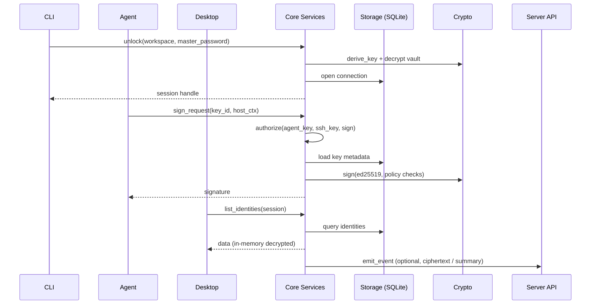

# Overall Architecture

> This page describes the current code's technical layering and module
> interactions. For product positioning, vision, capability boundaries, and the
> overall conceptual design, see
> [Product Positioning and Overall Architecture](/en/design/product). After the
> 2026-10-12 audit and once batches 1/2 landed, this page is aligned with the
> code; for concept-level implementation status labels
> (Implemented/Partial/Planned/Unverified), see
> [Overall Architecture (Overview)](/en/overview/architecture) and the
> [architecture implementation status audit report](https://github.com/cuihairu/persona/blob/main/docs/review/2026-10-12-audit-report.md).

## Layered Design

| Layer                   | Submodules                                                                                                                      | Notes                                                                                                                                                                                                         |
| ----------------------- | ------------------------------------------------------------------------------------------------------------------------------- | ------------------------------------------------------------------------------------------------------------------------------------------------------------------------------------------------------------- |
| Presentation layer      | CLI, Desktop, SSH Agent, future mobile clients                                                                                  | Owns the interaction experience, command routing, notifications, and so on; never touches plaintext data directly — it only goes through core service calls                                                   |
| Core domain layer       | `core/src/service.rs` (the PersonaService monolith), `core/src/models/`, `core/src/storage/` (the repositories)                 | Carries the domain models, validation, and policy gates (e.g. SSH signing confirmation, re-authentication for sensitive operations, Connect scopes)                                                           |
| Authorization layer     | `core/src/authz.rs` (`authorize(principal, resource, action, ctx)`)                                                             | The single pure policy decision point: the four entry points converge here; `InteractionRequired` is fulfilled at the call edge and folds into Denied in non-interactive contexts; stateless, writes no audit |
| Security & crypto layer | `core::crypto` (PBKDF2 master key derivation, Argon2id password-verification hash and backup file encryption, AES-GCM, ed25519) | Centralizes key derivation, ciphertext wrapping, and key-sealing policies so server and clients stay consistent; unaware of authorization/audit                                                               |
| Data & storage layer    | `core::storage` (`sqlx` + SQLite)                                                                                               | Workspace v2 schema, migrations, attachment storage, audit log                                                                                                                                                |
| Optional services layer | `server` (Axum)                                                                                                                 | Audit events, E2EE sync relay (conflict resolution happens on the client); no Connect endpoints                                                                                                               |

## Module Interactions

> **How this maps to the code (updated after the 2026-10-12 audit, once
> batches 1/2 landed)**: in `unlock`, the master key is derived with
> PBKDF2-HMAC-SHA256 (password verification uses Argon2id); after unlocking, an
> AES-GCM wrapping service is held in memory (`core/src/service.rs:82`) and
> unwraps per-item keys on demand; every entry-point request passes the pure
> decision in `core/src/authz.rs::authorize` first, then the stateful gates in
> each mechanism layer; the conditional policy checks of `sign_request` live in
> `agents/ssh-agent/src/policy.rs` (their four-state decisions are mapped back
> to the unified vocabulary via `to_authz`); `emit_event` is best-effort async
> (batching + exponential backoff, dropped on failure).

## Data Storage

- **Workspace DB**: a SQLite file recording identities, credentials, SSH keys,
  settings, and more. The schema is managed via `sqlx::migrate!` and the file
  lives at `~/.persona/identities.db` by default (`cli/src/config/mod.rs:199`;
  the workspace path can be overridden with `PERSONA_WORKSPACE_PATH`).
- **Encrypted form**: there is no separate "vault encryption container file" —
  plaintext exists only inside SQLite ciphertext columns, encrypted item by item
  with per-item keys wrapped by the master key (derived with
  PBKDF2-HMAC-SHA256; password verification uses Argon2id,
  `core/src/crypto/key_hierarchy.rs`). The master key never touches disk; it is
  derived fresh at unlock. The only exceptions are the backup/travel sidecar
  (`PERSENC1` format, Argon2id 64MiB + AES-256-GCM,
  `core/src/backup/file_crypto.rs`) and the biometric wrap blob
  (`core/src/auth/biometric_wrap.rs`).
- **Attachment storage**: binary blobs (implemented; encrypted on disk, reusing
  the owning credential's item key, named after their content hash; not
  included in sync).
- **Audit log**: the SQLite `audit_logs` table
  (`core/src/storage/repository.rs:1158`), recording CRUD, signatures, logins,
  and other operations. The local database is the source of record, and remote
  replication goes through the `core::events` Emitter best-effort async
  (dropped on failure — see [extension points](#extension-points) below).

## Extension Points

- **Server-side events**: core writes locally or remotely (Axum server,
  WebHook) through the `core::events::Emitter` abstraction, with batching and
  exponential backoff (dropped on failure, no replay; the local SQLite audit
  database remains the persistent source of record).
- **Authorization entry points**: `core/src/authz.rs::authorize` is the single
  policy decision point, and all four entry points (core service surface /
  Connect data plane / SSH Agent / CLI export) are wired in. A new entry point
  only needs to construct `AuthzPrincipal` + `AuthzResource` + `AuthzAction`
  and call it; stateful gates stay in each mechanism layer.
- **Policy plugins**: the SSH Agent exposes policy traits (`PolicyEnforcer` in
  `agents/ssh-agent/src/policy.rs` plus `ApprovalHandler` in `approval.rs`),
  extensible to biometrics, full known_hosts verification, and approval
  workflows. The user-configurable rule engine on the core side
  (`core/src/auth/security_strategies.rs`; time / location / device / behavior
  / network conditions) has an evaluation skeleton but is not yet wired to any
  entry point — it remains a planned piece.
- **Connect data plane**: the `connect_*` methods of `core/src/service.rs` read
  the full token row (principal + scope + expiry); `ConnectTokenScope::validate`
  in `core/src/connect/token.rs` restricts verbs to a `{read, use}` subset —
  extending with a new verb means updating the enum, `validate`, and the
  `AuthzAction::connect_verb` mapping in lockstep.
- **Sync**: end-to-end encrypted credential sync is implemented — the server
  relays encrypted operation logs (oplog), and the client engine handles
  fetching, materialization, and conflict resolution (LWW decides the winning
  slot, with manual arbitration keeping both versions).

This design lets Persona work in a "purely offline" mode; server/sync and the
browser extension have landed, and the mobile side keeps a clean interface.
