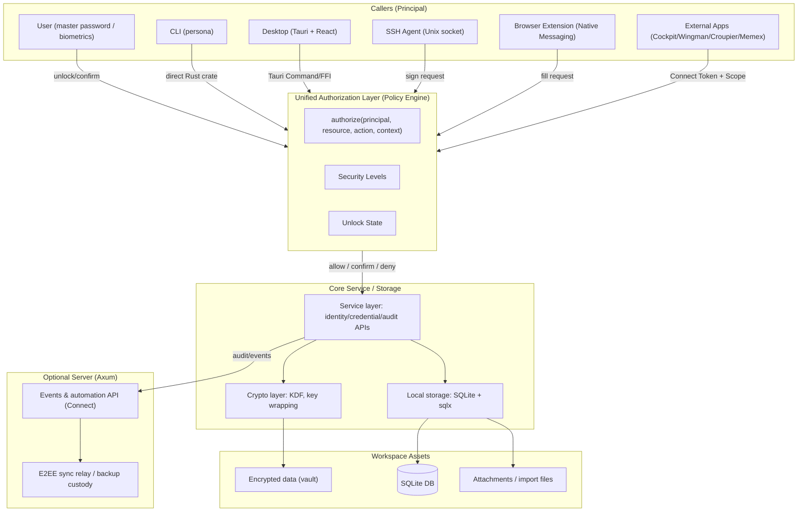
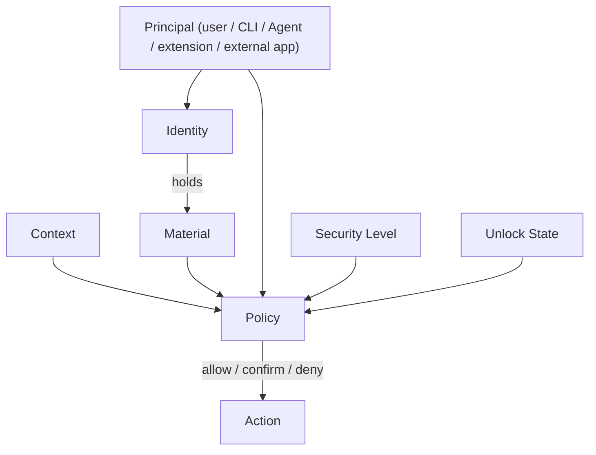

# Architecture

Persona uses a layered architecture of "encrypted core + multi-entry clients + optional
server", with all sensitive operations performed by the local Rust core library. The CLI,
desktop app, and SSH Agent share the same models/services/storage to maximize reuse; the
optional server handles event collection, the automation API, and end-to-end encrypted sync
relay.

Conceptually, Persona is a **digital identity runtime**: clients are UI/adapters, and the
core is the model and adjudicator. The six first-class concepts — persona, context,
material, policy, action, principal — are covered in
[Core Concepts](/en/concepts/index).

> **Implementation status annotations (2026-10-12 audit, updated after batches 1 and 2
> landed)**: this document describes both the target architecture and the current state.
> Each key concept is tagged [Implemented / Partial / Planned / Unverified]; the evidence
> is in the
> [architecture implementation status audit report](https://github.com/cuihairu/persona/blob/main/docs/review/2026-10-12-audit-report.md)
> and the
> [target architecture correction task list](https://github.com/cuihairu/persona/blob/main/docs/review/2026-10-12-target-architecture-correction.md).
> **Implemented** = the code exists and is testable; **Partial** = the mechanism exists but
> is not a first-class model or is used by only some entry points; **Planned** = a design
> direction with no code yet; **Unverified** = no conclusion could be drawn.

## Architecture Overview

**The diagram below is the target architecture**; how it differs from today's
implementation — the unified authorization layer and Principal identification (batches 1
and 2 landed) versus planned items such as Security Level enforcement — is annotated after
the diagram.

**Differences between the diagram and reality (target vs current implementation, updated
after batches 1 and 2 landed)**:

| Diagram node                                              | Status                       | Current state                                                                                                                                                                                                                                                                                                                             |
| --------------------------------------------------------- | ---------------------------- | ----------------------------------------------------------------------------------------------------------------------------------------------------------------------------------------------------------------------------------------------------------------------------------------------------------------------------------------- |
| `Principals` subgraph "Callers (Principal)"               | **Implemented**              | `core/src/authz.rs` `AuthzPrincipal` — three kinds: LocalSession / ConnectToken{scope} / AgentKey; each entry point constructs a principal and calls `authorize()` uniformly (still no "app registry"-style principal identity management — the Connect principal is a caller-supplied string)                                            |
| `AuthZ` "authorize(principal, resource, action, context)" | **Implemented**              | `core/src/authz.rs::authorize` is the pure policy adjudication point; the four entry points have converged (service `ensure_authorized`, Connect `token_allows_read`, the Agent signing entry, CLI export confirmation); `InteractionRequired` means the calling edge must fulfill it, and non-interactive contexts collapse it to Denied |
| `AuthZ` "verb model (read/use/export/sign)"               | **Implemented**              | `core/src/authz.rs` `AuthzAction` with four verbs; a Connect token may be granted a {read, use} subset, while export/sign can never be granted to a token                                                                                                                                                                                 |
| `AuthZ` "Security Levels"                                 | **Partial**                  | The `SecurityLevel` enum exists (`core/src/models/credential.rs:83`) but is a **pure label** — no authorization behavior branches on the level; the L4 independent-key boundary design is still undecided                                                                                                                                 |
| `AuthZ` "Unlock State"                                    | **Implemented**              | `core/src/service.rs:82-83` (in-memory master-key state) + `core/src/auth/auto_lock.rs` (background polling forces the lock) + re-authentication for sensitive actions (`core/src/auth/session.rs:105-113`)                                                                                                                               |
| `Core` subgraph "service/crypto/storage layers"           | **Implemented**              | `core/src/service.rs` (the PersonaService monolith), `core/src/crypto/`, `core/src/storage/`                                                                                                                                                                                                                                              |
| `Server` subgraph "events & automation API (Connect)"     | **Partial (wrong location)** | The Connect API is a **local** standalone crate, `connect-server/` (127.0.0.1, shared by desktop and CLI), not part of the `server/` optional cloud service; `server/` only has the event and sync endpoints                                                                                                                              |

**Authorization decision chain** (target model): all sensitive operations go through one
unified authorization entry point; the decision is based on:

- **Principal**: the caller (user / CLI / Agent / extension / external app) —
  **Implemented** (three `AuthzPrincipal` kinds; still no principal registry)
- **Resource**: the target credential (Identity + Credential) — **Implemented**
  (`AuthzResource`: Vault / Identity / Credential / SshKey)
- **Action**: the operation type (read / use / export / sign) — **Implemented**
  (`AuthzAction` with four verbs; Connect grants a {read, use} subset, and export/sign can
  never be granted to a token)
- **Context**: the calling context (interactive/non-interactive, origin) — **Partial**
  (`AuthzContext` {origin, interactive} exists and interactivity is a real gate, but
  context facts like hostname/origin/active_identity have not yet become first-class types)
- **Security Level**: the credential security tier (normal / sensitive / highly sensitive) —
  **Partial** (a pure label with no enforcement; see the table above)
- **Unlock State**: the current unlock state and authentication method — **Implemented**
  (see the table above)

**Where authorization is checked** (unified entry point + four entry-point mappings, batch 1
landed):

1. **Core service layer**: `ensure_authorized` (`core/src/service.rs`) = pure `authorize()`
   adjudication + the existing `ensure_sensitive_operation_allowed` (unlock +
   re-authentication for sensitive actions); shared by sensitive methods such as plaintext
   reads, export, and travel mode.
2. **Connect data plane**: `token_allows_read` = the 404-shaped mapping of `authorize()`
   (None/empty list, to prevent probing); the `connect-server` guard middleware (Bearer
   hash lookup, unlock gate, rate limiting).
3. **SSH Agent**: the signing entry first passes through `authorize()`'s Sign-only action
   boundary, and `SignatureDecision::to_authz` translates conditional policies into the
   unified vocabulary; `PolicyEnforcer` (confirmation/biometrics/rate limiting/known_hosts)
   remains at the mechanism layer.
4. **CLI export**: the two `ui.confirm` prompts fulfill Export→`InteractionRequired`, with
   the prompt text and defaults unchanged.

## Conceptual Layering

The left axis answers "who holds which persona's material"; the right axis answers "which
action is allowed in the current situation". The two axes meet in the Core authorization
layer: every entry-point request carries the originating principal, the target resource, the
intended action, and the context, and policy adjudicates them all uniformly, with the
decision recorded in the audit log. **Identity is where credentials belong; Principal is who
initiates the operation** — the two must not be merged. (The diagram above is the
conceptual model; the "unified adjudication" convergence point has landed as `authorize()`
in `core/src/authz.rs` — see "Where authorization is checked" above.)

**Concept implementation status** (updated after batches 1 and 2 landed; code evidence in
the audit report):

| Concept                   | Status          | Code evidence                                                                                                                                                                                               |
| ------------------------- | --------------- | ----------------------------------------------------------------------------------------------------------------------------------------------------------------------------------------------------------- |
| Principal                 | **Implemented** | `core/src/authz.rs` `AuthzPrincipal` (LocalSession / ConnectToken{scope} / AgentKey); still no principal registry                                                                                           |
| Identity                  | **Implemented** | `core/src/models/identity.rs`; active pointer at `core/src/models/workspace.rs:17`                                                                                                                          |
| Context                   | **Partial**     | `AuthzContext` (origin + interactive) exists; context facts such as hostname/origin/active_identity have not yet become first-class types                                                                   |
| Material                  | **Implemented** | `core/src/models/credential.rs` (`CredentialData` + per-item key at `core/src/crypto/key_hierarchy.rs:12`)                                                                                                  |
| Policy                    | **Partial**     | The unified adjudication point is implemented (`core/src/authz.rs`); the conditional rule machine `SecurityStrategy` (`core/src/auth/security_strategies.rs`) is written but not wired up — a planned piece |
| Action                    | **Implemented** | `core/src/authz.rs` `AuthzAction` (Read/Use/Export/Sign); Connect grants a {read, use} subset                                                                                                               |
| Security Level            | **Partial**     | `core/src/models/credential.rs:83` four-level enum, a pure label with no enforcement                                                                                                                        |
| Unlock State              | **Implemented** | `core/src/service.rs:82` + `core/src/auth/auto_lock.rs` + `core/src/auth/session.rs`                                                                                                                        |
| Unified `authorize` entry | **Implemented** | `core/src/authz.rs::authorize`; the four entry points have converged (see "Where authorization is checked")                                                                                                 |
| Audit                     | **Implemented** | The SQLite `audit_logs` table (`core/src/storage/repository.rs:1158`) + remote replication in `core/src/events/emitter.rs`; scope denials are audited (batch 2)                                             |

## Security Level Model

| Level            | Examples                              | Protection requirements                                                |
| ---------------- | ------------------------------------- | ---------------------------------------------------------------------- |
| Normal           | Website passwords                     | Readable once unlocked                                                 |
| Sensitive        | API keys, server passwords            | Unlock + user confirmation                                             |
| Highly sensitive | SSH private keys, wallet seed phrases | Unlock + confirmation + policy check; **automation denied by default** |

> **Current state (updated after batches 1 and 2 landed)**: the table above is the **target
> protection model**. In the current code, `SecurityLevel`
> (`core/src/models/credential.rs:83`, Critical/High/Medium/Low) is a pure label: apart
> from display, import defaults, and statistics, no behavior branches on the level; once
> the main vault is unlocked, material of every level decrypts equally under the same
> master-key chain (no independent key boundary). The tiered protection that does exist
> today is a different set of mechanisms: re-authentication for sensitive actions
> (`ensure_sensitive_operation_allowed`), the item-passphrase second factor for wallet
> seeds (`core/src/models/credential.rs:305`), SSH signing policies, and the sensitive-type
> exclusion in Connect scopes — they take effect by **material category**, not by the
> security_level field. The L4 (highly sensitive) independent-key boundary design is still
> undecided and will not be decided in this round.

## Controlled Automation Contract

External apps (Cockpit/Wingman/Croupier/Memex) access credentials through the Connect API
and must satisfy:

1. **Principal binding**: a Connect Token binds to an explicit Principal (the app's
   identity) — **Implemented** (migration 019 `principal` column, caller-supplied, up to
   256 characters; still no app registry — the binding is a self-declared string)
2. **Resource scope**: the token is limited to a list of Identity + Credential —
   **Implemented** (three dimensions of `identities` + `item_types` + `verbs`, with
   sensitive types excluded by omission, `core/src/connect/token.rs:47-73`)
3. **Action scope**: distinguishes read (fetch data) from use (sign/generate codes);
   **reading is not using** — **Implemented** (verb subset `{read, use}`, enforced by
   `validate` at creation; export/sign are not Connect verbs, so no scope can ever grant
   them; a use-only token cannot read the data plane)
4. **Validity**: short-lived tokens (minutes) + long-lived tokens (revocable) —
   **Partial** (an **absolute expiry time exists**: `expires_at` (migration 019, NULL =
   never expires; expiry and revocation are rejected identically in `connect_authenticate`,
   rate-limited and audited); but there is **no fixed-duration short-token policy** — the
   "5-minute short token" is still to be designed)
5. **Audit**: every access records the full authorization decision chain (Principal +
   Resource + Action + Context) — **Partial** (token-level events created/used/revoked +
   rate-limited authentication failures; **scope denials are audited** (batch 2,
   `UnauthorizedAccess`, rate-limited to avoid flooding); still no full decision chain at
   the Principal/Context level)

**Key rules** (design intent and current state):

- Being able to read a password does not mean being able to export a private key — ✅
  holds (Connect `export`/`sign` can never be granted to a token; local export goes through
  CLI confirmation, with `authorize` returning `InteractionRequired`)
- Being able to sign with a private key does not mean being able to obtain the key material
  — ✅ holds (the SSH Agent only outputs signatures and has no export endpoint; `authorize`
  denies Export of an `SshKey` in non-interactive contexts)
- Interactive scenarios (explicit user confirmation) and non-interactive scenarios
  (unattended scripts) use different authorization conditions — ✅ holds:
  `InteractionRequired` collapses to `Denied` in non-interactive contexts (fail-closed,
  never waiting for a confirmation that will not come); the CLI has the
  `--yes`/`PERSONA_NON_INTERACTIVE` bypass (must be enabled explicitly)

## Component Responsibilities

- **Core (Rust)**: the domain service behind every entry point; owns the models such as
  Identity and Credential (Material); encapsulates encryption policy, key derivation
  (PBKDF2 master-key chain + Argon2id passphrase verification), and signing; holds the
  sensitive-operation gate (`ensure_sensitive_operation_allowed`) and the unified
  authorization adjudication point (`core/src/authz.rs`) — no client entry point may bypass
  core to read or write sensitive plaintext directly; provides audit-event hooks.
- **Policy Engine**: the unified authorization entry point, deciding allow/confirm/deny
  from Principal/Resource/Action/Context/UnlockState — **Implemented** (`authorize()` in
  `core/src/authz.rs`; `InteractionRequired` is fulfilled by the calling edge. Security
  Level does not take part in adjudication — it is a pure label; the unwired
  `SecurityStrategy` rule machine at `core/src/auth/security_strategies.rs` is a planned
  piece, do not rely on it)
- **Storage**: SQLite via sqlx (Workspace v2), a unified migration mechanism, plus storage
  interfaces for attachments and import files.
- **CLI**: the command-line entry point; depends on the core crate directly and handles
  workspace initialization, unlocking, interactive input, and automation-script scenarios
  (`--yes`/`PERSONA_NON_INTERACTIVE` explicit bypass).
- **Desktop**: the Tauri shell exposing Rust commands to the React UI, reusing core unlock
  logic; owns UI state, notifications, and quick actions; the SSH/Passkey approval bridge
  (`desktop/src-tauri/src/approval.rs`, auto-deny after a 120s timeout).
- **SSH Agent**: a long-lived daemon exposing the OpenSSH Agent protocol over a Unix
  socket. All key loading/signing calls back into the core service; policies
  (confirmation/biometrics/rate limiting/known_hosts, `agents/ssh-agent/src/policy.rs`),
  logging, and rate limiting are self-contained; the signing action boundary first passes
  `authorize()`'s Sign-only adjudication, and there is **no export endpoint**.
- **Connect Server**: a local HTTP service (127.0.0.1, standalone crate `connect-server/`)
  providing controlled credential access to external apps. Tokens bind a Principal
  (self-supplied string) + Resource Scope (three dimensions) + the verb subset `{read, use}`
  - an expiry time; hashes are persisted, revocation and expiry take effect immediately,
    and the server is off by default — no exposure without listening; scope denials write an
    `UnauthorizedAccess` audit entry.
- **Server (optional)**: Axum + sqlx; handles event collection and the end-to-end encrypted
  sync relay (ciphertext operation log, device-envelope custody, group-key rotation mutual
  exclusion). The server touches only ciphertext or event digests and never decrypts user
  data; no Connect endpoints.

## Data Flow and Security Mechanisms

1. **Unlock**: CLI/desktop/Agent request a core unlock; the core verifies the passphrase
   hash with Argon2id, derives the master key with PBKDF2-HMAC-SHA256, builds an in-memory
   AES-GCM wrapping service, and unwraps each item's wrapped item key on demand (the vault
   is SQLite ciphertext columns, not an encrypted container; see the key-hierarchy section
   of the
   [audit report](https://github.com/cuihairu/persona/blob/main/docs/review/2026-10-12-audit-report.md)).
   Unlock state feeds into authorization decisions.
2. **Authorize**: sensitive operations pass through the unified authorization entry
   `authorize()` (`core/src/authz.rs`) — pure policy adjudication plus mechanism-layer
   state gates (session lock / auto-lock / sensitive re-authentication / token revocation
   and expiry lookups / Agent host rules); `InteractionRequired` is fulfilled by the calling
   edge and collapses to `Denied` in non-interactive contexts; denials and
   sensitive-operation outcomes are written to the audit log.
3. **Business operations**: clients perform identity/credential/key CRUD through the core
   service layer. All writes happen locally and are mirrored into the audit log (the
   SQLite `audit_logs` table).
4. **SSH signing**: the Agent receives a `sign_request`, first passes the Sign-only action
   boundary of `authorize()`, then the policy checks (confirmation, human verification,
   rate limiting, known_hosts), and signs with the in-memory private key. Signing is a
   `sign` action, not a `read`; the Agent has no export endpoint.
5. **Controlled automation**: external apps request credentials with a Connect Token; the
   core verifies the token's Principal binding, its Resource/Action (read/use subset)
   scope, its expiry time, and the vault unlock state; scope denials write an
   `UnauthorizedAccess` audit entry.
6. **Optional event reporting**: audit events land in local SQLite first (the source of
   record), then the `core::events` Emitter pushes them to the server best-effort and
   asynchronously (batching + exponential backoff; failures are dropped, not replayed).

This architecture keeps Persona highly modular while holding to "local-first + end-to-end
encryption (the server sees only ciphertext)": new client features only need to call the
core services; server extensions never touch plaintext; the SSH Agent and the desktop share
the crypto and storage implementations, cutting maintenance cost. (For terminology, see the
[Introduction](/en/overview/introduction#terminology-why-end-to-end-encrypted-and-not-zero-knowledge).)
