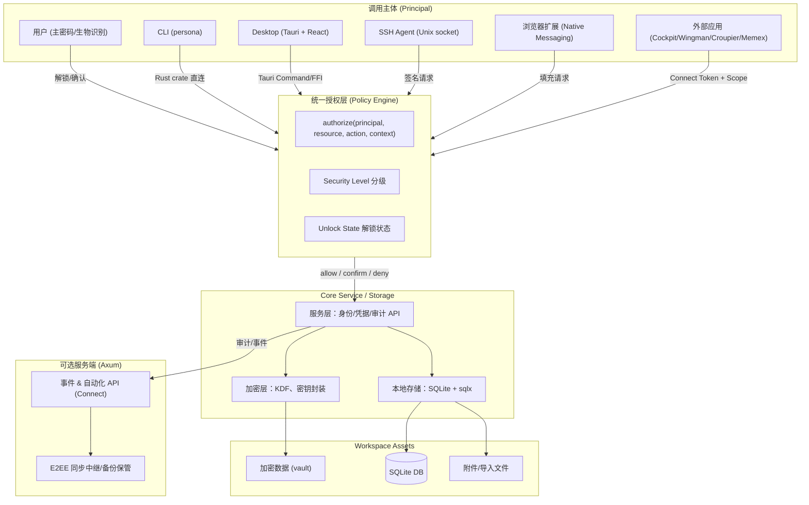
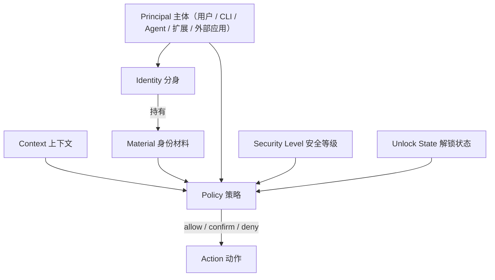

# 技术架构

Persona 采用”加密核心 + 多入口客户端 + 可选服务端”的分层架构，所有敏感操作都由本地 Rust 核心库完成。CLI、桌面端、SSH Agent 共享同一套模型/服务/存储，最大化复用能力；可选服务端承担事件收集、自动化 API 与端到端加密同步中继。

概念上，Persona 是**数字身份运行时**：客户端是 UI/adapter，核心是模型与裁决者。六个一级概念（分身、上下文、材料、策略、动作、主体）见[核心概念](/concepts/index)。

## 架构总览

**授权决策链**：所有敏感操作经过统一授权入口，决策依据为：

- **Principal**: 调用主体（用户/CLI/Agent/扩展/外部应用）
- **Resource**: 目标凭证（Identity + Credential）
- **Action**: 操作类型（read / use / fill / sign / export）
- **Context**: 调用上下文（交互/非交互、来源、时间）
- **Security Level**: 凭证安全等级（普通/敏感/高敏）
- **Unlock State**: 当前解锁状态与认证方式

## 概念分层

左侧轴回答"谁持有哪个分身的哪些材料"，右侧轴回答"当前处境下哪个动作被放行"，
两条轴在 Core 授权层汇合：每个入口请求都同时携带来源主体、目标资源、动作意图与上下文，
由策略统一裁决并落审计。**Identity 是凭证归属，Principal 是发起操作者**，两者不能合并。

## 安全等级模型

| 等级 | 示例                 | 保护要求                                   |
| ---- | -------------------- | ------------------------------------------ |
| 普通 | 网站密码             | 解锁即可读                                 |
| 敏感 | API Key、服务器密码  | 解锁 + 用户确认                            |
| 高敏 | SSH 私钥、钱包助记词 | 解锁 + 确认 + 策略检查，**默认拒绝自动化** |

## 受控自动化契约

外部应用（Cockpit/Wingman/Croupier/Memex）通过 Connect API 访问凭证，必须满足：

1. **主体绑定**：Connect Token 绑定明确 Principal（应用身份）
2. **资源范围**：Token 限定可访问的 Identity + Credential 列表
3. **操作范围**：区分 read（读取）/ use（签名）/ fill（填充），**读取 ≠ 使用**
4. **有效期**：短期 Token（分钟级）+ 长期 Token（可撤销）
5. **审计**：每次访问记录完整授权决策链（Principal + Resource + Action + Context）

**关键规则**：

- 能读取密码 ≠ 可以导出私钥
- 能使用私钥签名 ≠ 可以取得私钥原文
- 交互场景（用户主动确认）与非交互场景（无人值守脚本）使用不同授权条件

## 组件职责

- **Core (Rust)**：入口统一的领域服务，负责身份（Identity）、材料（Credential）等模型；封装加解密策略、密钥派生 (Argon2id) 与签名操作；是**策略 (Policy) 的唯一裁决点**——各客户端入口一律不能绕过 core 直接读写敏感明文；提供审计事件钩子。
- **Policy Engine**：统一授权入口，综合 Principal/Resource/Action/Context/SecurityLevel/UnlockState 做出 allow/confirm/deny 决策。
- **Storage**：通过 sqlx 访问 SQLite（Workspace v2），统一迁移机制，附带附件/导入文件存储接口。
- **CLI**：命令行入口，直接依赖 core crate，负责工作区初始化、解锁、交互式输入以及自动化脚本场景。
- **Desktop**：Tauri shell 暴露 Rust 命令给 React UI，重用核心解锁逻辑；负责 UI 状态、通知、快捷操作。
- **SSH Agent**：长期驻留进程，通过 Unix socket 暴露 OpenSSH Agent 协议。所有密钥加载/签名都回调 core 服务，继承统一策略、日志与速率限制。
- **Connect Server**：本机 HTTP 服务（127.0.0.1），为外部应用提供受控凭证访问。Token 绑定 Principal + Resource Scope + Action Scope，默认关闭，不监听就不暴露。
- **Server（可选）**：Axum + sqlx，负责事件收集、端到端加密同步中继（密文操作日志、设备信封保管、组密钥轮换互斥）。Server 只接触密文或事件摘要，不会解密用户数据。

## 数据流与安全机制

1. **解锁**：CLI/桌面/Agent 请求核心解锁；核心使用 Argon2id 将主密码派生成密钥，解密工作区 vault，并缓存短期 session key。解锁状态纳入授权决策。
2. **授权**：所有敏感操作经过 Policy Engine，决策结果写入审计日志。
3. **业务操作**：客户端通过核心服务层执行身份/凭据/密钥 CRUD。所有写入在本地完成，并同步写入审计日志。
4. **SSH 签名**：Agent 接收 `sign_request`，核心检查策略（确认、人机验证、频率限制、known_hosts），然后用内存中的私钥执行签名。签名是 `use` 操作，不是 `read`。
5. **受控自动化**：外部应用持 Connect Token 请求凭证，核心验证 Token 的 Principal/Resource/Action 绑定，按安全等级决定是否放行。
6. **可选事件上报**：审计事件可以串行写入本地日志，也可以通过 `core::events` 模块推送到 server，供同步或自动化使用。

此架构让 Persona 在”本地优先 + 端到端加密（服务器只见密文）”的前提下保持高度模块化：客户端新增功能只需调用核心服务；服务端扩展不会接触明文；SSH Agent 与桌面端共享加密与存储实现，降低维护成本。（术语口径见[项目简介](/overview/introduction#术语说明为什么说端到端加密而不是零知识)。）
