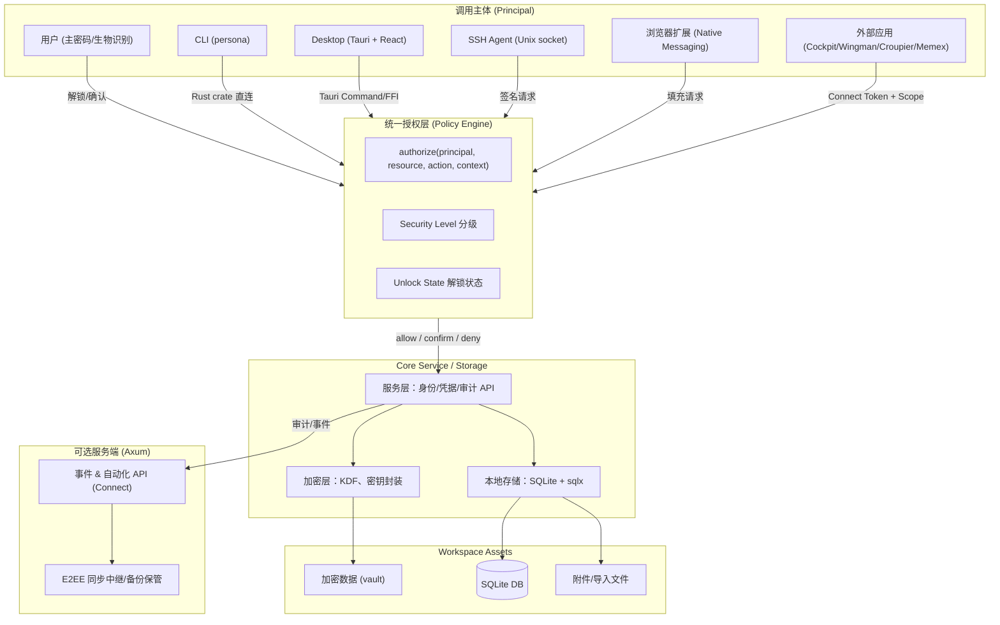
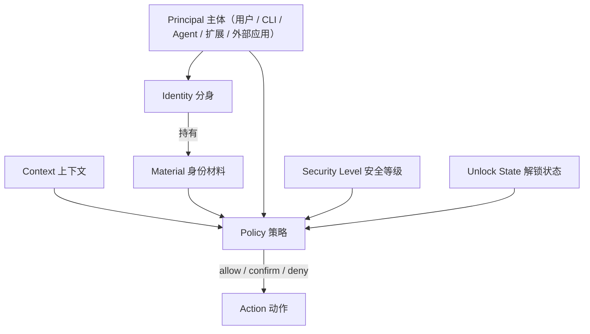

# 技术架构

Persona 采用”加密核心 + 多入口客户端 + 可选服务端”的分层架构，所有敏感操作都由本地 Rust 核心库完成。CLI、桌面端、SSH Agent 共享同一套模型/服务/存储，最大化复用能力；可选服务端承担事件收集、自动化 API 与端到端加密同步中继。

概念上，Persona 是**数字身份运行时**：客户端是 UI/adapter，核心是模型与裁决者。六个一级概念（分身、上下文、材料、策略、动作、主体）见[核心概念](/concepts/index)。

> **实现状态标注（2026-10-12 审计）**：本文同时描述目标架构与现状。
> 每个关键概念标注 [Implemented / Partial / Planned]，依据见
> [架构实现状态审计报告](https://github.com/cuihairu/persona/blob/main/docs/review/2026-10-12-audit-report.md)。
> **Implemented** = 代码存在且可测试；**Partial** = 机制存在但未成为一级模型或仅部分入口使用；
> **Planned** = 设计方向，代码尚不存在。

## 架构总览

**下图是目标架构**；规划组件（统一授权层、Principal 识别）与已实现组件的差异在图后标注。

**图与现状的差异（目标 vs 当前实现，2026-10-12 审计）**：

| 图中节点                                                 | 状态                    | 现状                                                                                                                                            |
| -------------------------------------------------------- | ----------------------- | ----------------------------------------------------------------------------------------------------------------------------------------------- |
| Principals 子图「调用主体 (Principal)」                  | **Planned**             | 无 Principal 类型（全仓零定义）；各入口直接持有 session/scope 调用核心服务                                                                      |
| AuthZ「authorize(principal, resource, action, context)」 | **Planned**             | 不存在统一 `authorize()`；授权分散在四套机制（见下「当前实现的授权检查位置」）                                                                  |
| AuthZ「Security Level 分级」                             | **Partial**             | `SecurityLevel` 枚举存在（`core/src/models/credential.rs:83`），但是**纯标签**——无任何按等级分支的授权行为                                      |
| AuthZ「Unlock State」                                    | **Implemented**         | `core/src/service.rs:82-83`（内存主密钥态）+ `core/src/auth/auto_lock.rs`（后台巡检强锁）+ 敏感操作再认证（`core/src/auth/session.rs:105-113`） |
| Core 子图「服务层/加密层/存储层」                        | **Implemented**         | `core/src/service.rs`（PersonaService 单体）、`core/src/crypto/`、`core/src/storage/`                                                           |
| Server 子图「事件 & 自动化 API (Connect)」               | **Partial（位置不符）** | Connect API 是**本机**独立 crate `connect-server/`（127.0.0.1，桌面与 CLI 共用），不在 `server/` 可选云服务里；`server/` 只有事件与同步端点     |

**授权决策链**（目标模型）：所有敏感操作经过统一授权入口，决策依据为：

- **Principal**: 调用主体（用户/CLI/Agent/扩展/外部应用）—— **Planned**（类型不存在）
- **Resource**: 目标凭证（Identity + Credential）—— **Implemented**（UUID 寻址 + Connect scope 资源维）
- **Action**: 操作类型（read / use / fill / sign / export）—— **Partial**（`ConnectVerb` 只有 `Read`，`core/src/connect/token.rs:58`；SSH sign 与 CLI export 各自独立、无共享模型）
- **Context**: 调用上下文（交互/非交互、来源、时间）—— **Partial**（事实散在各入口：known_hosts 主机名、浏览器 origin、active_identity；无一级 Context 类型）
- **Security Level**: 凭证安全等级（普通/敏感/高敏）—— **Partial**（纯标签无强制，见上表）
- **Unlock State**: 当前解锁状态与认证方式 —— **Implemented**（见上表）

**当前实现的授权检查位置**（无统一入口，四套机制并存）：

1. **core 服务层门禁**（最接近统一）：`ensure_sensitive_operation_allowed`（`core/src/service.rs:431`）——解锁 + 敏感操作再认证，读明文/导出/旅行模式等 10+ 敏感方法共用，CLI 与桌面数据面间接覆盖；
2. **Connect 数据面**：token 三维 scope 内联裁决（`core/src/service.rs:2292-2294`）+ `connect-server` guard 中间件（Bearer 哈希查表、解锁门禁、限速）；
3. **SSH Agent**：`PolicyEnforcer::check_signature`（`agents/ssh-agent/src/lib.rs:276`）——确认/生物识别/速率限制/known_hosts，四态决策；
4. **CLI 导出**：`ui.confirm` 交互确认（`cli/src/commands/export.rs:73-95`）。

## 概念分层

左侧轴回答"谁持有哪个分身的哪些材料"，右侧轴回答"当前处境下哪个动作被放行"，
两条轴在 Core 授权层汇合：每个入口请求都同时携带来源主体、目标资源、动作意图与上下文，
由策略统一裁决并落审计。**Identity 是凭证归属，Principal 是发起操作者**，两者不能合并。
（上图为概念模型；「统一裁决」的汇聚点在当前代码中尚不存在——见上方四套授权机制的现状。）

**概念实现状态**（2026-10-12 审计，代码依据见审计报告）：

| 概念                | 状态            | 代码依据                                                                                                                            |
| ------------------- | --------------- | ----------------------------------------------------------------------------------------------------------------------------------- |
| Principal 主体      | **Planned**     | 全仓无类型定义；文档概念（见[主体](/concepts/principal)）                                                                           |
| Identity 分身       | **Implemented** | `core/src/models/identity.rs`；active 指针 `core/src/models/workspace.rs:17`                                                        |
| Context 上下文      | **Partial**     | 无一级类型；事实散在 known_hosts / origin binding / active_identity                                                                 |
| Material 材料       | **Implemented** | `core/src/models/credential.rs`（`CredentialData` + per-item key `core/src/crypto/key_hierarchy.rs:12`）                            |
| Policy 策略         | **Partial**     | 散点硬门槛（SSH 策略/自动锁/再认证/Connect scope）；`SecurityStrategy` 规则机（`core/src/auth/security_strategies.rs`）已写但未接线 |
| Action 动作         | **Partial**     | `ConnectVerb` 仅 `Read`（`core/src/connect/token.rs:58`）；SSH 仅 sign；无共享 Action 模型                                          |
| Security Level      | **Partial**     | `core/src/models/credential.rs:83` 四级枚举，纯标签无强制                                                                           |
| Unlock State        | **Implemented** | `core/src/service.rs:82` + `core/src/auth/auto_lock.rs` + `core/src/auth/session.rs`                                                |
| 统一 authorize 入口 | **Planned**     | 不存在；四套机制并存（见「当前实现的授权检查位置」）                                                                                |
| 审计                | **Implemented** | SQLite `audit_logs` 表（`core/src/storage/repository.rs:1158`）+ `core/src/events/emitter.rs` 远端复制                              |

## 安全等级模型

| 等级 | 示例                 | 保护要求                                   |
| ---- | -------------------- | ------------------------------------------ |
| 普通 | 网站密码             | 解锁即可读                                 |
| 敏感 | API Key、服务器密码  | 解锁 + 用户确认                            |
| 高敏 | SSH 私钥、钱包助记词 | 解锁 + 确认 + 策略检查，**默认拒绝自动化** |

> **现状（2026-10-12 审计）**：上表是**目标保护模型**。当前代码中
> `SecurityLevel`（`core/src/models/credential.rs:83`，Critical/High/Medium/Low）
> 是纯标签：展示、导入默认值、统计计数之外无任何按等级分支的行为；
> 主 vault 解锁后所有等级材料在同一把主密钥链下同等可解（无独立密钥边界）。
> 现实中存在的等级化保护是另一组机制：敏感操作再认证
> （`ensure_sensitive_operation_allowed`）、钱包种子的条目密码第二因子
> （`core/src/models/credential.rs:305`）、SSH 签名策略与 Connect scope
> 的敏感类型排除——它们按**材料类别**而非 security_level 字段生效。

## 受控自动化契约

外部应用（Cockpit/Wingman/Croupier/Memex）通过 Connect API 访问凭证，必须满足：

1. **主体绑定**：Connect Token 绑定明确 Principal（应用身份）—— **Planned**（Token 无 principal 字段，`core/src/connect/token.rs:106`；调用方仅以 token 指纹间接区分）
2. **资源范围**：Token 限定可访问的 Identity + Credential 列表 —— **Implemented**（`identities` + `item_types` 两维，敏感类型排除法，`core/src/connect/token.rs:47-73`）
3. **操作范围**：区分 read（读取）/ use（签名）/ fill（填充），**读取 ≠ 使用** —— **Partial**（verb 只有 `Read` 且创建期强制，token.rs:58-81；「读取 ≠ 使用」目前靠 Connect 只读 + SSH/导出走别的入口这一结构事实成立，不是被表达的规则）
4. **有效期**：短期 Token（分钟级）+ 长期 Token（可撤销）—— **Partial**（**无过期机制**，永不过期仅吊销，`core/migrations/015_connect_tokens.sql:13-15`；吊销即时生效）
5. **审计**：每次访问记录完整授权决策链（Principal + Resource + Action + Context）—— **Partial**（记录 token 维度事件：created/used/revoked + 认证失败节流；**scope 拒绝不落审计**，无 Principal/Context 维度）

**关键规则**（设计意图与现状）：

- 能读取密码 ≠ 可以导出私钥 —— ✅ 结构上成立（Connect 只读、导出走 CLI 确认）
- 能使用私钥签名 ≠ 可以取得私钥原文 —— ✅ 成立（SSH Agent 只输出签名；Connect scope 排除 SSH 类型）
- 交互场景（用户主动确认）与非交互场景（无人值守脚本）使用不同授权条件 —— ⚠️ 部分成立：CLI 有 `--yes`/`PERSONA_NON_INTERACTIVE` 旁路（需显式启用），Connect 数据面本身即无人值守形态（纯 token 裁决，无用户确认步骤）

## 组件职责

- **Core (Rust)**：入口统一的领域服务，负责身份（Identity）、材料（Credential）等模型；封装加解密策略、密钥派生（PBKDF2 主密钥链 + Argon2id 口令验证）与签名操作；持有敏感操作门禁（`ensure_sensitive_operation_allowed`）——各客户端入口一律不能绕过 core 直接读写敏感明文；提供审计事件钩子。（统一**授权**裁决点是规划目标，见上文。）
- **Policy Engine**：统一授权入口，综合 Principal/Resource/Action/Context/SecurityLevel/UnlockState 做出 allow/confirm/deny 决策。—— **Planned**（尚不存在；现状是四套分散机制 + 未接线的 `SecurityStrategy` 规则机 `core/src/auth/security_strategies.rs`）
- **Storage**：通过 sqlx 访问 SQLite（Workspace v2），统一迁移机制，附带附件/导入文件存储接口。
- **CLI**：命令行入口，直接依赖 core crate，负责工作区初始化、解锁、交互式输入以及自动化脚本场景（`--yes`/`PERSONA_NON_INTERACTIVE` 显式旁路）。
- **Desktop**：Tauri shell 暴露 Rust 命令给 React UI，重用核心解锁逻辑；负责 UI 状态、通知、快捷操作；SSH/Passkey 审批桥（`desktop/src-tauri/src/approval.rs`，120s 超时自动拒绝）。
- **SSH Agent**：长期驻留进程，通过 Unix socket 暴露 OpenSSH Agent 协议。所有密钥加载/签名都回调 core 服务，策略（确认/生物识别/速率限制/known_hosts，`agents/ssh-agent/src/policy.rs`）、日志与速率限制独立完备。
- **Connect Server**：本机 HTTP 服务（127.0.0.1，独立 crate `connect-server/`），为外部应用提供受控凭证访问。Token 绑定 Resource Scope + 只读 Action Scope（Principal 绑定为规划项），哈希落库、吊销即时生效，默认关闭，不监听就不暴露。
- **Server（可选）**：Axum + sqlx，负责事件收集、端到端加密同步中继（密文操作日志、设备信封保管、组密钥轮换互斥）。Server 只接触密文或事件摘要，不会解密用户数据。

## 数据流与安全机制

1. **解锁**：CLI/桌面/Agent 请求核心解锁；核心用 Argon2id 验证口令哈希、以 PBKDF2-HMAC-SHA256 派生主密钥，在内存中构造 AES-GCM 封装服务并按需解开各条目的包裹 item key（vault 是 SQLite 密文列，非加密容器；见[审计报告](https://github.com/cuihairu/persona/blob/main/docs/review/2026-10-12-audit-report.md)密钥层次节）。解锁状态纳入授权决策。
2. **授权**：敏感操作经过授权检查（现状四套机制见上；统一 Policy Engine 为规划项），解锁门禁与敏感操作再认证的结果写入审计日志。
3. **业务操作**：客户端通过核心服务层执行身份/凭据/密钥 CRUD。所有写入在本地完成，并同步写入审计日志（SQLite `audit_logs` 表）。
4. **SSH 签名**：Agent 接收 `sign_request`，策略检查（确认、人机验证、频率限制、known_hosts），然后用内存中的私钥执行签名。签名是 `use` 操作，不是 `read`。
5. **受控自动化**：外部应用持 Connect Token 请求凭证，核心验证 Token 的 Resource/Action（read-only）scope 与 vault 解锁态；Principal 绑定与等级化放行为规划项。
6. **可选事件上报**：审计事件先落本地 SQLite（存证源），再由 `core::events` Emitter 尽力异步推送到 server（批量 + 指数退避，失败丢弃不回补）。

此架构让 Persona 在”本地优先 + 端到端加密（服务器只见密文）”的前提下保持高度模块化：客户端新增功能只需调用核心服务；服务端扩展不会接触明文；SSH Agent 与桌面端共享加密与存储实现，降低维护成本。（术语口径见[项目简介](/overview/introduction#术语说明为什么说端到端加密而不是零知识)。）
