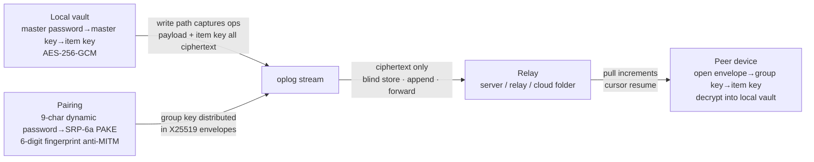

# How Sync Works

**In one sentence**: persona's cross-device sync is **end-to-end encrypted
oplog sync** — the group key never leaves your devices; the relay (server,
relay binary, or cloud-drive folder) only ever sees ciphertext and takes part
in no merge decision. Zero accounts, zero sign-up: pairing uses a one-time
dynamic password, not a cloud identity.

This page is the **user-level integration guide**: which sync mode to pick,
how data flows, what happens offline and on conflict, and where self-hosting
starts. Design details (key hierarchy, protocol endpoints, threat
registrations) live in the "Deep dives" links at the end; they are not
duplicated here.

## The three modes at a glance

persona has **one sync protocol** (oplog + group-key E2EE); what differs is
where the ciphertext lives and who carries it:

| Mode                      | Ciphertext lives in                          | Best for                                                                            |
| ------------------------- | -------------------------------------------- | ----------------------------------------------------------------------------------- |
| **Server sync (default)** | persona-server (hosted / self-hosted / LAN)  | Everyday multi-device use with a live relay                                         |
| **Cloud-drive sync**      | iCloud Drive / Dropbox / Google Drive folder | No server of your own, distrust of third-party servers, cloud drive on every device |
| **Account mode (opt-in)** | persona account system                       | Convenience seekers; **off unless you turn it on**                                  |

Two naming traps, cleared up first:

- **"Cross-device sync" and "sync group mode" are the same thing** — the
  default mode: one device shows a short-lived dynamic password, the other
  types it in to join the group. Zero accounts, end-to-end encrypted.
- The three deployment shapes under server sync (**officially hosted**,
  **self-hosted relay**, **LAN relay**) run the **same persona-server
  binary**; clients only change `base_url`, and sync behavior is identical.

## Data flow

Key points (each taken from the design docs, see "Deep dives"):

1. **Local encryption unchanged**: sync does not touch the local storage
   format — local items are encrypted with an item key wrapped by the master
   key; in the sync wire format the same item key is wrapped by the **group
   key** instead, so **changing the master password is a purely local
   operation** — no fleet-wide re-wrap, zero sync impact.
2. **Accountless pairing**: one device emits a 9-character dynamic password
   (Crockford base32, single use); the other types it in and an SRP-6a PAKE
   exchange derives the strong key — the short code itself is never a key,
   blocking brute force and man-in-the-middle; a **6-digit fingerprint**
   cross-check guards against MITM. The group key is handed over wrapped in
   AES-256-GCM.
3. **The group key never leaves devices**: it is generated on a device and
   exists on the server only as "device envelopes" (one per device, sealed
   to its X25519 public key). The relay has no decryption path at all.
4. **Zero-knowledge relay**: the server sees only ciphertext payloads, item
   UUIDs, type enums, Lamport counters, timestamps, device public keys, and
   envelope sizes — **no plaintext names / URLs / usernames**; item metadata
   is sealed inside the ciphertext. A `server_stores_only_ciphertext`
   assertion test locks this in.

## The relay's role: dumb encrypted courier

The relay (persona-server, persona-relay, or a cloud-drive folder) is a
**pure intermediary**: it blind-stores ops in arrival order and forwards by
cursor — **no winner-picking, no merging**. Conflict arbitration lives in
clients; letting the server arbitrate would hand semantics to a component
whose honesty we refuse to trust.

The relay options differ only in operations:

| Relay                | What it is                                                                                                                                 |
| -------------------- | ------------------------------------------------------------------------------------------------------------------------------------------ |
| Official hosting     | persona's own persona-server deployment, the default path                                                                                  |
| persona-relay (self) | Thin image: the persona-server library mounting only sync + the pairing mailbox — no account / events / backup endpoints; multi-arch image |
| LAN relay            | The same persona-server bound to an on-site LAN address, zero WAN                                                                          |
| Cloud-drive folder   | No server at all: encrypted op shards + immutable snapshots + envelopes land in your own cloud folder, moved by the OS cloud agent         |

Two honest footnotes for the cloud-drive mode: the folder is an
**availability** trust boundary (folder unreachable = no sync; the settings
page distinguishes "cloud folder unavailable" from "server unreachable");
and cloud-drive shards get **no physical compaction** (server transport
prunes old ops when a snapshot lands; the cloud-drive snapshot is only a
logical checkpoint, shards keep full history).

**Red line**: never put the active `identities.db` inside a cloud-synced
folder — SQLite assumes exclusive writes; bidirectional cloud sync risks
real corruption. The cloud transport writes only per-device ciphertext
shards, never SQLite.

## Idempotency, resume points, snapshots

- **Idempotency**: every op carries an `op_id` (UUID); re-pushes and replays
  dedupe on it — retrying after disconnects and crashes is safe.
- **Resume**: pulls continue incrementally from the `since` cursor; a device
  back from a long offline stretch catches up from where it left off.
- **Snapshots**: past a threshold (1000 ops) a **whole-vault ciphertext
  snapshot** is taken automatically and old ops are compacted; new devices
  (or empty-vault returns) start from the snapshot plus post-snapshot
  increments instead of replaying all history. "Snapshot start + increments
  == full replay" is locked by a two-device convergence-equivalence test.

## What happens on conflict

**In one sentence**: a Lamport clock defines the total order (higher lamport
wins, ties broken by device ID — both ends compute the same winner
independently); **true conflicts** (two devices editing the same item
offline) **keep both versions** for the user to arbitrate in the UI —
nothing is silently overwritten; deletes are tombstones so an offline delete
cannot be resurrected by an old version.

The server takes part in none of this.

## Device lifecycle

- **Register → pending**: after a new device registers (its private key lives
  in the OS keychain), it cannot read the group key yet — pending state,
  fails closed on every item.
- **Authorize**: any in-group device confirms, then seals a group-key
  envelope for the newcomer; it can decrypt from then on.
- **Free to come and go**: the device list is visible to all members (you can
  only edit your own remark); leaving is one click.
- **Revocation ≠ rotation**: revoking a device cuts its credentials and
  tokens immediately, but **history it already saw while in the group cannot
  be retroactively un-keyed** (honest boundary, no forward secrecy). To close
  that window, use "Rotate group key" — a new group key plus full re-wrap,
  with its own entry and confirmation copy on the desktop settings page.
- **Visible status**: the sync panel shows the group's latest version, this
  device's synced watermark, "up to date / N ops behind", and last sync time.

## Data safety and self-rescue

Losing every device = losing the vault (no account to recover from) — the
price of "don't trust the server". Two self-rescue tools, and the UI keeps
nagging until you have either:

1. **Pair another device** (dynamic password pairing);
2. **Export an encrypted backup** (a PERSENC1-encrypted file — see the
   backups section in [Security Design](./security)).

A strong prompt appears when you first enable sync; until a second device or
an export exists, the settings page keeps a standing warning.

Two more boundaries, stated plainly: **sync pauses entirely while Travel
Mode is active** (push and pull both stop, so removed identities cannot be
written back); and **attachments do not travel the oplog** (v1 syncs vault
rows only; attachments ride the backup channel).

## Self-hosting entry points

| Image                             | Contents                                                                          |
| --------------------------------- | --------------------------------------------------------------------------------- |
| `ghcr.io/cuihairu/persona-server` | Full persona-server: sync + pairing + events + backups + auth, all endpoints      |
| `ghcr.io/cuihairu/persona-relay`  | Sync + pairing-mailbox thin shell: the minimal surface when you only want a relay |

- Self-hosting persona-server (compose / cargo / Docker): see
  [SELF_HOST_SERVER.md](https://github.com/cuihairu/persona/blob/main/docs/SELF_HOST_SERVER.md).
- Running persona-relay (env vars, health check, ports): see
  [README-relay.md](https://github.com/cuihairu/persona/blob/main/README-relay.md).

On the client, switching shapes changes nothing but the server URL (for the
cloud transport, just pick a folder) — one protocol, switch any time.

## Deep dives

- [E2EE Sync Design](https://github.com/cuihairu/persona/blob/main/docs/E2EE_SYNC_DESIGN.md)
  — full design: key hierarchy, SRP auth, snapshot protocol, threat
  registrations
- [Cross-device sync (the default)](https://github.com/cuihairu/persona/blob/main/docs/sync-group-mode.md)
  — pairing protocol and implementation ledger
- [Cloud-drive sync transport](https://github.com/cuihairu/persona/blob/main/docs/CLOUD_DRIVE_SYNC.md)
  — folder layout and cursor design of the cloud transport
- [Sync API](../api/sync) — the `/api/v1/sync/*` endpoint reference
- [SELF_HOST_SERVER.md](https://github.com/cuihairu/persona/blob/main/docs/SELF_HOST_SERVER.md) /
  [README-relay.md](https://github.com/cuihairu/persona/blob/main/README-relay.md)
  — runbooks for the two self-hostable images

## Related pages

- [Security Design](./security) — encryption and key hierarchy from the user's view
- [Identity](./identity) — sync organizes data by identity context
- [FAQ](./faq) / [Troubleshooting](./troubleshooting)
