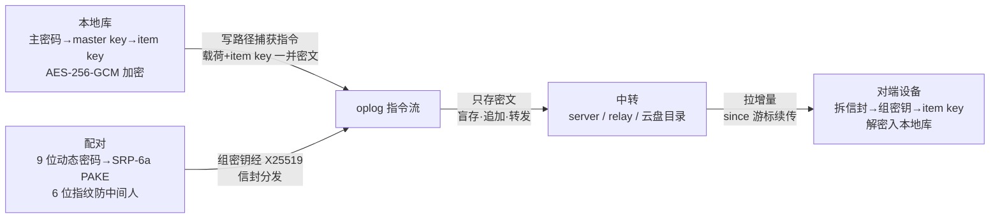

# 同步方案

**一句话**：persona 的跨设备同步是**端到端加密的指令流同步**——组密钥永远
不出设备，中转（服务器、relay 或云盘目录）只见密文，不参与任何合并裁决。
零账号、零注册：配对靠一次性动态密码，不靠云端账户。

这页是**用户视角的整合介绍**：三种同步方式怎么选、数据怎么流动、断网与
冲突怎么处理、想自托管从哪进。设计细节（密钥层级、协议端点、威胁登记）
在文末「深读」链接里，本文不重复。

## 三种用法一览

persona 的同步**协议只有一份**（指令流 + 组密钥 E2EE），差别只在「密文放在
哪、谁搬运」：

| 方式                       | 密文放在哪                                 | 适合谁                                           |
| -------------------------- | ------------------------------------------ | ------------------------------------------------ |
| **server 同步（默认）**    | persona-server（官方托管 / 自建 / 局域网） | 想要实时中转的常规多设备使用                     |
| **云盘目录同步**           | iCloud Drive / Dropbox / Google Drive 目录 | 不想自建、不信任第三方服务器，但每台设备都有云盘 |
| **账号模式（需显式开启）** | persona 账号体系                           | 「方便派」；**不开不用**，不是默认路径           |

两个常见的名字混淆，先说清：

- **「跨设备同步」和「同步组模式」是同一件事**——默认模式：一端出短时效
  动态密码，另一端输入配对入组，零账号、端到端加密。
- server 同步下的三种部署形态（**官方托管**、**自建 relay**、**局域网自建
  中转**）跑的是**同一个 persona-server 二进制**，客户端只换 `base_url`，
  同步行为完全一致。

## 数据流

要点（每一条都来自设计稿，详见「深读」）：

1. **本地加密不变**：同步不动本地存储格式——本地条目由 master key 包裹的
   item key 加密；同步传输格式里同一 item key 改由**组密钥**包裹，所以
   **换主密码是纯本地操作，不触发全网重包**，同步零影响。
2. **配对零账号**：一端出 9 位动态密码（Crockford base32、单次使用），另一端
   输入后经 SRP-6a PAKE 换出强钥——短码本身不作密钥，防爆破防中间人；再加
   **6 位短指纹**人工核对防 MITM。组密钥以 AES-256-GCM 包裹递交。
3. **组密钥永不出端**：组密钥在设备上生成，在服务器上只以「设备信封」形态
   存在（每台设备一个，用其 X25519 公钥密封）。中转方没有任何解密路径。
4. **中转零知识**：服务器可见面只有密文载荷、条目 UUID、类型枚举、Lamport
   计数、时间戳、设备公钥与信封尺寸——**没有任何明文名称 / URL / 用户名**，
   条目元数据也封在密文里。实现有 `server_stores_only_ciphertext` 断言测试
   锁定。

## 中转的角色：哑加密信使

中转（persona-server、persona-relay、云盘目录）是**纯中继**：按到达顺序
盲存指令、按游标转发，**不做任何胜负判定或合并**——合并裁决在客户端，
让服务器裁决等于把语义交给一个我们拒绝信任其诚实的组件。

三种中转的定位差异只在运维面：

| 中转                  | 是什么                                                                                       |
| --------------------- | -------------------------------------------------------------------------------------------- |
| 官方托管              | persona 官方部署的 persona-server，默认路径                                                  |
| persona-relay（自建） | 薄壳镜像：persona-server 库只挂同步 + 配对信箱两个面，不含账号 / 事件 / 备份端点；多架构镜像 |
| 局域网自建中转        | 同一 persona-server 绑到现场设备局域网地址，零外网                                           |
| 云盘目录              | 无服务器：加密指令分片 + 不可变快照 + 信封落在你自己的云盘目录，OS 云代理搬运                |

云盘方式额外两条诚实登记：目录是**可用性**信任边界（目录不可达 = 无法同步，
设置页会以「云盘目录不可用」与「服务器不可达」区分报错）；云盘分片**无物理
压缩**（服务器传输会在快照上传时裁剪旧指令，云盘版快照只是逻辑检查点，分片
保留全量历史）。

**红线**：绝不要把活跃的 `identities.db` 放进云盘同步目录——SQLite 假定独占
写，云盘双向同步会产生真实损坏风险。云盘方式只写每设备密文分片，没有
SQLite。

## 幂等、断点与快照

- **幂等**：每条指令带 `op_id`（UUID），重推 / 重放按它去重——断网重试、
  崩溃恢复都安全。
- **断点**：拉取从 `since` 游标起增量续传；长期离线的设备回归后从中断点
  继续追平。
- **快照**：积压指令超过阈值（1000 条）自动打一份**整库密文快照**，压缩旧
  指令；新设备入组或空库回归时「快照起步 + 点后增量」，不用重放全史。
  「快照起步 + 点后增量 == 全量重放」有双设备收敛等价性测试锁定。

## 冲突怎么办

**一句话**： Lamport 时钟定全序（lamport 大者赢，相等按设备 ID 定序），
两端独立计算结果必然一致；**真冲突**（两台设备离线各改同一条目）**保双
版本**等用户在 UI 裁决，绝不静默覆盖；删除记墓碑，防离线删除被旧版本复活。

服务器不参与以上任何判定。

## 设备生命周期

- **注册 → 待授权**：新设备生成自己的密钥对（私钥存 OS 钥匙串）注册后，还
  读不到组密钥——处于待授权状态，解不开任何条目（fail-closed）。
- **授权**：任一在组设备确认后为其封一个组密钥信封上传，新设备即可解密。
- **进出组自由**：组内设备清单互见（只能改自己的备注），随时可退出。
- **吊销 ≠ 轮换**：吊销设备即刻断其认证与令牌，但**它入组期间已见过的历史
  密钥不可追溯撤销**（诚实边界，无前向安全）。要闭环历史，用「轮换组密钥」
  ——换组密钥 + 全量重包，桌面设置页有入口与确认文案。
- **状态可见**：同步面板显示组最新版本号、本机已同步水位、「已最新 / 落后
  N 条指令」与最近同步时间。

## 数据安全与自救

设备全丢 = 库全丢（无账号找回）——这是「信不过服务器」的对价。两件自救
装备，界面会持续提醒直到配齐其一：

1. **再连一台设备**（动态密码配对）；
2. **导出加密备份**（PERSENC1 加密文件，见 [安全设计](./security) 的备份
   节）。

首次启用同步时有强提示；未配齐第二设备或备份前，设置页警示常驻。

另外两条边界如实说明：**旅行模式激活期间同步整体暂停**（push/pull 双停，
防止把已移出身份的数据写回）；**附件不走同步**（v1 只同步库内行数据，附件
走备份通道）。

## 自托管入口

| 镜像                              | 内容                                                          |
| --------------------------------- | ------------------------------------------------------------- |
| `ghcr.io/cuihairu/persona-server` | 完整 persona-server：同步 + 配对 + 事件 + 备份 + 认证全部端点 |
| `ghcr.io/cuihairu/persona-relay`  | 同步 + 配对信箱薄壳：只想当中转、不想要其余端点时的最小面     |

- persona-server 自建（compose / cargo / Docker）：见
  [SELF_HOST_SERVER.md](../../reference/SELF_HOST_SERVER)。
- persona-relay 运行与配置面（环境变量、健康检查、端口）：见
  [README-relay.md](https://github.com/cuihairu/persona/blob/main/README-relay.md)。

客户端配置只差一个服务器地址（云盘方式则只需选目录）——三形态同一协议，
随时可换。

## 深读

- [E2EE 同步设计稿](../reference/E2EE_SYNC_DESIGN.zh)
  ——密钥层级、SRP 认证、快照协议、威胁登记的完整设计
- [跨设备同步（默认同步方式）](../reference/sync-group-mode.zh)
  ——配对协议与实现状态对账
- [云盘同步传输](../reference/CLOUD_DRIVE_SYNC.zh)
  ——云盘传输的目录布局与游标设计
- [同步 API](../api/sync) —— `/api/v1/sync/*` 端点参考
- [SELF_HOST_SERVER.md](../../reference/SELF_HOST_SERVER) /
  [README-relay.md](https://github.com/cuihairu/persona/blob/main/README-relay.md)
  ——自托管两个镜像的运行手册

## 相关页面

- [安全设计](./security) —— 加密与密钥层级的用户视角说明
- [身份（Identity）](./identity) —— 同步以身份上下文组织数据
- [常见问题](./faq) / [故障排除](./troubleshooting)
